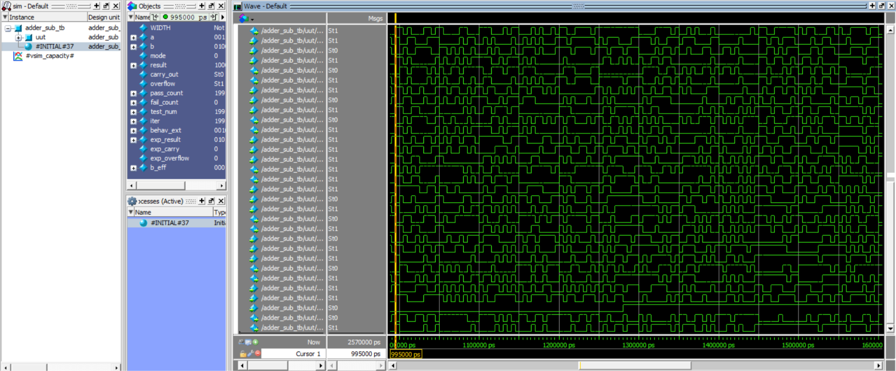
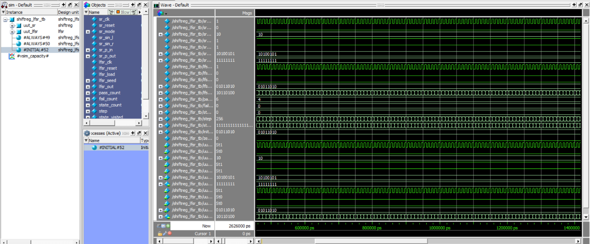
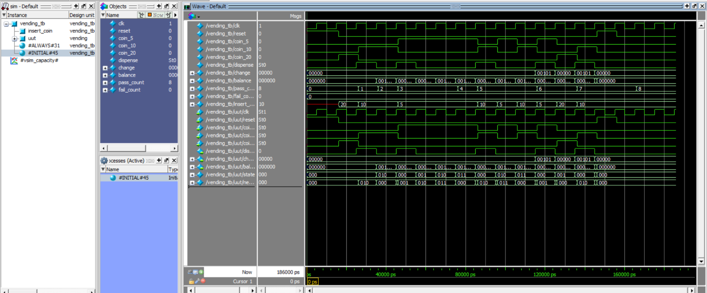
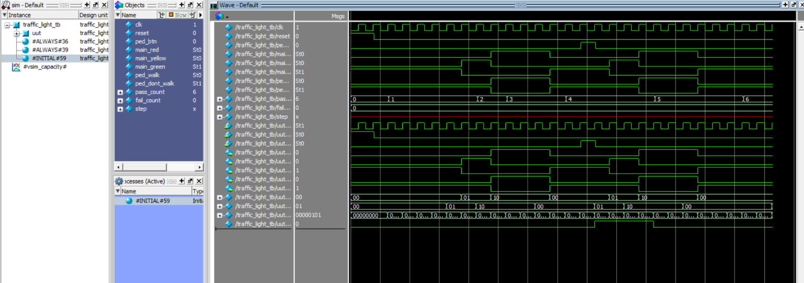
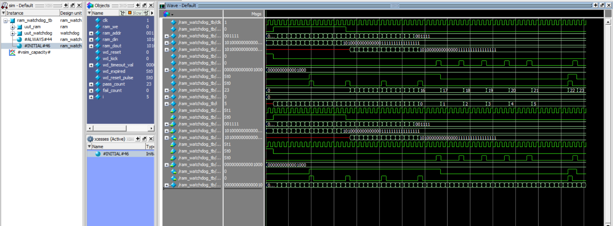

# Verilog HDL Digital Design Projects

> **🎓 Class Done ✅** — Verilog RTL Design & RISC-V Processor Development (4-Day Workshop)  
> **Student:** Bommu Gowtham Sai Reddy &nbsp;|&nbsp; **Trainer:** Yuvaraj Seenipandi — Infoziant | Kalasalingam University  
> **Status:** All 4 Days Completed — 1,688+ test assertions PASSED across Day 1–Day 4

A collection of digital logic designs, state machine controllers, pipelined processor architectures, and verification testbenches implemented in Verilog HDL, accompanied by functional simulation waveforms from ModelSim / QuestaSim.

---

## 📁 Repository Structure

```
Projects/
│
├── CLASS ROOM ACTIVITY/       ← 3-Day Classroom Activities & Designs
│   ├── 01_Alu_4bit/           ← 4-bit ALU
│   ├── 02_4bit_halfadder/     ← Half Adder
│   ├── 03_D_FlipFlop/         ← D Flip-Flop
│   ├── 04_Half_Adder_DFF/     ← Half Adder with DFF
│   ├── 05_4_Floor_Elevator/   ← Elevator FSM Controller
│   ├── 06_FSM/                ← Washing Machine FSM
│   ├── 07_ATM_Controller/     ← ATM Controller FSM
│   ├── 08_RISCV_2stage/       ← 2-Stage Pipelined RV32I Processor
│   └── 09_RISC_V_5Stage/      ← 5-Stage Pipelined RV32I Processor
│
├── day1/                      ← Workshop Day 1: Combinational & Sequential Blocks
│   ├── src/                   ← alu.v, counter.v, shifter.v, regfile.v ...
│   ├── tb/                    ← Self-checking testbenches
│   └── waves/                 ← .wlf waveform files
│
├── day2/                      ← Workshop Day 2: FSM Controllers & Memory
│   ├── src/                   ← seq_moore.v, fifo.v, atm.v, arbiter.v ...
│   ├── tb/
│   └── waves/
│
├── day3/                      ← Workshop Day 3: Single-Cycle RV32I CPU
│   ├── src/                   ← cpu.v, program1_sum.hex, program2_fib.hex ...
│   ├── tb/
│   └── waves/
│
├── day4/                      ← Workshop Day 4: 5-Stage Pipelined RV32I
│   ├── src/                   ← riscv_5stage.v, forwarding_unit.v, hazard_unit.v
│   ├── tb/
│   └── waves/
│
├── report/                    ← Workshop tech notes & design review reports
└── README.md
```

---

## 🛠️ Classroom Modules Overview (`CLASS ROOM ACTIVITY/`)

### 1. 4-Bit Arithmetic Logic Unit (`01_Alu_4bit/`)
Performs arithmetic and bitwise logical operations controlled by a 3-bit opcode selector with carry/borrow and zero flag generation.
- **Files**: [`alu4.v`](CLASS%20ROOM%20ACTIVITY/01_Alu_4bit/alu4.v), [`alu4_tb.v`](CLASS%20ROOM%20ACTIVITY/01_Alu_4bit/alu4_tb.v)
- **Inputs**: 4-bit operands `A`, `B`, 3-bit `opcode`
- **Outputs**: 4-bit `result`, 1-bit `carry_borrow`, 1-bit `zero` flag

| Opcode (`opcode[2:0]`) | Operation | Description | Flags Affected |
| :---: | :---: | :--- | :--- |
| `000` | **ADD** | Addition: `temp = A + B` | `carry_borrow` (carry out), `zero` |
| `001` | **SUB** | Subtraction: `result = A - B` | `carry_borrow` (borrow: `A < B`), `zero` |
| `010` | **AND** | Bitwise AND: `result = A & B` | `zero` |
| `011` | **OR** | Bitwise OR: `result = A \| B` | `zero` |
| `100` | **XOR** | Bitwise XOR: `result = A ^ B` | `zero` |
| Others | **Default** | Clears output (`4'b0000`) | `zero` |

#### ModelSim Simulation Commands
```tcl
cd "CLASS ROOM ACTIVITY/01_Alu_4bit"
pwd
vlib work
vmap work work
vlog alu4_tb.v alu4.v
vsim work.alu4_tb
add wave -r *
run -all
wave zoom full
```

#### Simulation Waveform


---

### 2. Half Adder (`02_4bit_halfadder/`)
Implements standard half adder addition on binary inputs (`A` and `B`) generating `Sum` and `Carry` outputs.
- **Files**: [`halfadder.v`](CLASS%20ROOM%20ACTIVITY/02_4bit_halfadder/halfadder.v), [`halfadder_tb.v`](CLASS%20ROOM%20ACTIVITY/02_4bit_halfadder/halfadder_tb.v)
- **Logic Equations**:
  - `Sum   = A ^ B` (Bitwise XOR)
  - `Carry = A & B` (Bitwise AND)
- **Truth Table**:

| `A` | `B` | `Sum` | `Carry` |
| :---: | :---: | :---: | :---: |
| 0 | 0 | 0 | 0 |
| 0 | 1 | 1 | 0 |
| 1 | 0 | 1 | 0 |
| 1 | 1 | 0 | 1 |

#### ModelSim Simulation Commands
```tcl
cd "CLASS ROOM ACTIVITY/02_4bit_halfadder"
pwd
vlib work
vmap work work
vlog halfadder_tb.v halfadder.v
vsim work.halfadder_tb
add wave -r *
run -all
wave zoom full
```

#### Simulation Waveform


---

### 3. D Flip-Flop (`03_D_FlipFlop/`)
Positive-edge triggered D flip-flop with active-high asynchronous reset.
- **Files**: [`d_flipflop.v`](CLASS%20ROOM%20ACTIVITY/03_D_FlipFlop/d_flipflop.v), [`d_flipflop_tb.v`](CLASS%20ROOM%20ACTIVITY/03_D_FlipFlop/d_flipflop_tb.v)
- **Ports**:
  - `clk`: Clock signal
  - `rst`: Asynchronous active-high reset
  - `d`: Data input
  - `q`: Registered output
- **Functionality**: When `rst = 1`, `q` is cleared to `0`. On `posedge clk` with `rst = 0`, `q <= d`.

#### ModelSim Simulation Commands
```tcl
cd "CLASS ROOM ACTIVITY/03_D_FlipFlop"
pwd
vlib work
vmap work work
vlog d_flipflop_tb.v d_flipflop.v
vsim work.d_flipflop_tb
add wave -r *
run -all
wave zoom full
```

#### Simulation Waveform


---

### 4. Half Adder with D Flip-Flop (`04_Half_Adder_DFF/`)
Sequential half adder combining combinational logic with edge-triggered output registration.
- **Files**: [`half_adder_dff.v`](CLASS%20ROOM%20ACTIVITY/04_Half_Adder_DFF/half_adder_dff.v), [`half_adder_dff_tb.v`](CLASS%20ROOM%20ACTIVITY/04_Half_Adder_DFF/half_adder_dff_tb.v)
- **Ports**:
  - `clk`, `reset`: Clock and asynchronous active-high reset
  - `a`, `b`: 1-bit operands
  - `sum`, `carry`: Registered outputs captured on the clock edge
- **Functionality**:
  - Combinational logic: `s = a ^ b`, `c = a & b`
  - Registered outputs: On rising clock edge (`posedge clk`), `sum <= s` and `carry <= c`. When `reset = 1`, `sum <= 0` and `carry <= 0`.

#### ModelSim Simulation Commands
```tcl
cd "CLASS ROOM ACTIVITY/04_Half_Adder_DFF"
pwd
vlib work
vmap work work
vlog half_adder_dff_tb.v half_adder_dff.v
vsim work.half_adder_dff_tb
add wave -r *
run -all
wave zoom full
```

#### Simulation Waveform


---

### 5. 4-Floor Elevator Controller (`05_4_Floor_Elevator/`)
Finite State Machine (FSM) based controller for a 4-floor passenger elevator with motor direction, door timing control, and busy signaling.
- **Files**: [`elevator.v`](CLASS%20ROOM%20ACTIVITY/05_4_Floor_Elevator/elevator.v), [`elevator_tb.v`](CLASS%20ROOM%20ACTIVITY/05_4_Floor_Elevator/elevator_tb.v)
- **Inputs**: `clk`, `reset`, `request_valid`, `request_floor[1:0]` (Floors 0 to 3)
- **Outputs**: `current_floor[1:0]`, `motor_up`, `motor_down`, `door_open`, `busy`
- **FSM States**:
  - `IDLE (00)`: Evaluates target floor against current floor upon `request_valid`.
  - `UP (01)`: Asserts `motor_up`, increments floor on each clock cycle until reaching target floor.
  - `DOWN (10)`: Asserts `motor_down`, decrements floor on each clock cycle until reaching target floor.
  - `DOOR (11)`: Asserts `door_open`, holds for door countdown cycles before returning to `IDLE`.

#### ModelSim Simulation Commands
```tcl
cd "CLASS ROOM ACTIVITY/05_4_Floor_Elevator"
pwd
vlib work
vmap work work
vlog elevator_tb.v elevator.v
vsim work.elevator_tb
add wave -r *
run -all
wave zoom full
```

#### Simulation Waveform


---

### 6. Washing Machine Controller (`06_FSM/`)
Synthesizable Moore Finite State Machine controller managing a multi-stage automated laundry sequence with sensor handshaking.
- **Files**: [`washing_machine.v`](CLASS%20ROOM%20ACTIVITY/06_FSM/washing_machine.v), [`washing_machine_tb.v`](CLASS%20ROOM%20ACTIVITY/06_FSM/washing_machine_tb.v)
- **Inputs**: `clk`, `reset`, `start`, `water_full`, `wash_done`, `drain_done`, `rinse_done`, `spin_done`
- **Outputs**: `water_valve`, `wash_motor`, `drain_pump`, `spin_motor`, `cycle_done`
- **Cycle Stages & FSM Sequence**:

| State | Encoding | Trigger Condition | Active Actuator Output |
| :--- | :---: | :--- | :--- |
| `IDLE` | `000` | `start = 1` | None |
| `FILL` | `001` | `water_full = 1` | `water_valve = 1` |
| `WASH` | `010` | `wash_done = 1` | `wash_motor = 1` |
| `DRAIN` | `011` | `drain_done = 1` | `drain_pump = 1` |
| `RINSE` | `100` | `rinse_done = 1` | `water_valve = 1` / rinse |
| `SPIN` | `101` | `spin_done = 1` | `spin_motor = 1` |
| `DONE` | `110` | `start = 1` (restart) | `cycle_done = 1` |

#### ModelSim Simulation Commands
```tcl
cd "CLASS ROOM ACTIVITY/06_FSM"
pwd
vlib work
vmap work work
vlog washing_machine_tb.v washing_machine.v
vsim work.washing_machine_tb
add wave -r *
run -all
wave zoom full
```

#### Simulation Waveform


---

### 7. ATM Controller (`07_ATM_Controller/`)
Comprehensive Finite State Machine modeling an Automated Teller Machine (ATM) controller verifying card insertion, 16-bit PIN validation, balance checks, cash dispensing, and error handling.
- **Files**: [`atm_controller.v`](CLASS%20ROOM%20ACTIVITY/07_ATM_Controller/atm_controller.v), [`atm_controller_tb.v`](CLASS%20ROOM%20ACTIVITY/07_ATM_Controller/atm_controller_tb.v)
- **Inputs**: `clk`, `reset`, `card_insert`, `pin[15:0]`, `pin_enter`, `withdraw`, `amount[7:0]`, `balance[7:0]`
- **Outputs**: `cash_dispense`, `card_return`, `pin_error`, `insufficient_balance`, `transaction_done`
- **FSM States**:
  - `IDLE (000)`: Waits for `card_insert`.
  - `PIN (001)`: Awaits user PIN input (`pin_enter`).
  - `VERIFY (010)`: Authenticates PIN (validates against stored PIN `1234`). Branches to `MENU` on success or `ERROR` on failure.
  - `MENU (011)`: Awaits user transaction selection (`withdraw`).
  - `CHECK (100)`: Validates withdrawal `amount <= balance`.
  - `DISPENSE (101)`: Asserts `cash_dispense = 1`.
  - `DONE (110)`: Asserts `card_return = 1` and `transaction_done = 1`, then returns to `IDLE`.
  - `ERROR (111)`: Flags `pin_error` or `insufficient_balance`, asserts `card_return = 1`, and resets to `IDLE`.

#### ModelSim Simulation Commands
```tcl
cd "CLASS ROOM ACTIVITY/07_ATM_Controller"
pwd
vlib work
vmap work work
vlog atm_controller_tb.v atm_controller.v
vsim work.atm_controller_tb
add wave -r *
run -all
wave zoom full
```

#### Simulation Waveform


---

### 8. 2-Stage Pipelined 32-Bit RISC-V Processor (`08_RISCV_2stage/`)
A synthesizable 32-bit RISC-V processor implementing a 2-stage pipeline with separate Harvard-style instruction and data memories.
- **Files**: [`riscv_2stage.v`](CLASS%20ROOM%20ACTIVITY/08_RISCV_2stage/riscv_2stage.v), [`tb_riscv_2stage.v`](CLASS%20ROOM%20ACTIVITY/08_RISCV_2stage/tb_riscv_2stage.v)
- **Pipeline Architecture**:
  - **Stage 1 (IF - Instruction Fetch)**: Fetches 32-bit instructions from `instruction_mem` addressed by the Program Counter (`pc`). Handles branch redirection and flushes pipeline with `NOP` on taken branches.
  - **Stage 2 (EX - Decode, Execute, Memory & Write-Back)**: Decodes instructions, reads source registers from a 32-entry register file (`registers[0:31]`, `x0 = 0`), performs arithmetic/logical operations in the ALU, accesses `data_mem`, and writes results back to the destination register (`rd`).
- **Supported Instructions**:

| Instruction | Type | Syntax | Operation |
| :--- | :---: | :--- | :--- |
| `ADD` | R | `add rd, rs1, rs2` | `rd = rs1 + rs2` |
| `SUB` | R | `sub rd, rs1, rs2` | `rd = rs1 - rs2` |
| `AND` | R | `and rd, rs1, rs2` | `rd = rs1 & rs2` |
| `OR` | R | `or rd, rs1, rs2` | `rd = rs1 \| rs2` |
| `ADDI` | I | `addi rd, rs1, imm` | `rd = rs1 + imm` |
| `LW` | I | `lw rd, offset(rs1)` | `rd = data_mem[rs1 + offset]` |
| `SW` | S | `sw rs2, offset(rs1)` | `data_mem[rs1 + offset] = rs2` |
| `BEQ` | B | `beq rs1, rs2, offset` | If `rs1 == rs2`, `pc = pc + offset` (flushes pipeline with `NOP`) |

#### ModelSim Simulation Commands
```tcl
cd "CLASS ROOM ACTIVITY/08_RISCV_2stage"
pwd
vlib work
vmap work work
vlog tb_riscv_2stage.v riscv_2stage.v
vsim work.tb_riscv_2stage
add wave -r *
run -all
wave zoom full
```

#### Simulation Waveforms


---

### 9. 5-Stage Pipelined 32-Bit RISC-V Processor (`09_RISC_V_5Stage/`)
A synthesizable 32-bit RISC-V processor implementing the classic 5-stage pipeline architecture with complete data forwarding, hazard detection, and branch flushing units.
- **Files**: [`riscv_5stage.v`](CLASS%20ROOM%20ACTIVITY/09_RISC_V_5Stage/riscv_5stage.v), [`riscv_5stage_tb.v`](CLASS%20ROOM%20ACTIVITY/09_RISC_V_5Stage/riscv_5stage_tb.v)
- **Pipeline Stages**:
  - **IF (Instruction Fetch)**: Manages `pc`, fetches 32-bit instructions from `instruction_mem`, and handles branch redirection.
  - **ID (Instruction Decode / Register Read)**: Decodes opcode, funct3, and funct7, reads operands from 32-entry register file (`registers[0:31]`, `x0 = 0`), and generates sign-extended immediates (`imm_i`, `imm_s`, `imm_b`).
  - **EX (Execute / Address Calculation)**: Computes arithmetic/logic operations in the ALU, resolves branch condition (`BEQ`), and dynamically selects forwarded operands from later pipeline stages.
  - **MEM (Memory Access)**: Accesses `data_mem` for load (`LW`) and store (`SW`) operations.
  - **WB (Write Back)**: Selects between ALU computation result and memory read data to write back to destination register (`rd`).
- **Hazard Handling & Forwarding**:
  - **Forwarding Unit**: Eliminates RAW (Read-After-Write) data stalls by forwarding results from `EX/MEM` and `MEM/WB` stages directly into the ALU inputs.
  - **Hazard Detection Unit**: Detects load-use data hazards and stalls the pipeline by freezing `pc` and `IF/ID`, inserting a bubble into `ID/EX`.
  - **Branch Flushing**: Flushes `IF/ID` and `ID/EX` pipeline registers with `NOP` (`0x00000013`) upon taken branches.
- **Supported Instructions**:

| Instruction | Type | Syntax | Operation |
| :--- | :---: | :--- | :--- |
| `ADD` | R | `add rd, rs1, rs2` | `rd = rs1 + rs2` |
| `SUB` | R | `sub rd, rs1, rs2` | `rd = rs1 - rs2` |
| `AND` | R | `and rd, rs1, rs2` | `rd = rs1 & rs2` |
| `OR` | R | `or rd, rs1, rs2` | `rd = rs1 \| rs2` |
| `ADDI` | I | `addi rd, rs1, imm` | `rd = rs1 + imm` |
| `LW` | I | `lw rd, offset(rs1)` | `rd = data_mem[rs1 + offset]` |
| `SW` | S | `sw rs2, offset(rs1)` | `data_mem[rs1 + offset] = rs2` |
| `BEQ` | B | `beq rs1, rs2, offset` | If `rs1 == rs2`, `pc = branch_target` (flushes pipeline with `NOP`) |

#### ModelSim Simulation Commands
```tcl
cd "CLASS ROOM ACTIVITY/09_RISC_V_5Stage"
pwd
vlib work
vmap work work
vlog riscv_5stage_tb.v riscv_5stage.v
vsim work.riscv_5stage_tb
add wave -r *
run -all
wave zoom full
```

#### Simulation Waveforms


---

## 🚀 Simulation & Verification Reference

### General ModelSim / QuestaSim Transcript Workflow

| Step | Command | Description |
| :---: | :--- | :--- |
| **01** | `pwd` | Verify current working directory |
| **02** | `vlib work` | Create the local design library |
| **03** | `vmap work work` | Map the library as default work library |
| **04** | `vlog <testbench>.v <design>.v` | Compile design and testbench files |
| **05** | `vsim work.<testbench_module>` | Load testbench for simulation |
| **06** | `add wave -r *` | Add all signals recursively to waveform window |
| **07** | `run -all` | Execute simulation run |
| **08** | `wave zoom full` | Zoom to fit all waveforms in window |


---

## 🎓 Workshop Assignment: Verilog RTL Design & RISC-V Processor Development (4-Day)

**Trainer:** Yuvaraj Seenipandi — Infoziant | Kalasalingam University  
**Student:** Bommu Gowtham Sai Reddy  
**Result:** ✅ Class Done — All 4 Days Completed

---

### Day 1 — Combinational & Sequential Building Blocks (`day1/`)

| Activity | Module | Description | Tests |
| :--- | :--- | :--- | :---: |
| 1.1 | `alu.v` | 32-bit Parameterized ALU (ADD, SUB, AND, OR, XOR, SLT, SLL, SRL) with flags | 27 PASSED |
| 1.2 | `counter.v` | 8-bit Up/Down Counter with Sync Reset, Enable, Parallel Load | 15 PASSED |
| 1.3 | `shifter.v` | 32-bit Barrel Shifter (SLL, SRL, SRA by 0–31) | 480 PASSED |
| 1.4 | `regfile.v` | 32x32 Register File, hardwired x0=0, write-bypass forwarding | 264 PASSED |
| 1.5 | `adder_sub.v` | Structural 8-bit Ripple-Carry Adder/Subtractor with generate | 512 PASSED |
| 1.6 | `encoder.v`, `decoder.v` | 8-to-3 Priority Encoder (casez vs if-else) + 3-to-8 Decoder | 272 PASSED |
| 1.7 | `shiftreg.v`, `lfsr.v` | Universal Shift Register + 8-bit Maximal-Length LFSR (255 states) | 6 PASSED |
| 1.8 | `debounce.v`, `edge_detect.v` | Counter Debouncer + 2-Stage Synchronizer Edge Detector | 6 PASSED |

---

#### 1.1 — Parameterized 32-Bit Arithmetic Logic Unit
A synthesizable, parameterized ALU supporting 8 core arithmetic and bitwise logic operations with comprehensive status flag generation.
- **Files**: [`alu.v`](day1/src/alu.v), [`alu_tb.v`](day1/tb/alu_tb.v)
- **Parameters**: `WIDTH = 32` (default data bus width)
- **Inputs**: `a[WIDTH-1:0]`, `b[WIDTH-1:0]`, `alu_ctrl[3:0]` (Operation selector)
- **Outputs**: `alu_out[WIDTH-1:0]`, `zero`, `negative`, `carry`, `overflow`
- **Supported Operations**:

| `alu_ctrl[3:0]` | Operation | Description | Flag Generation |
| :---: | :---: | :--- | :--- |
| `0000` | **ADD** | Addition: `alu_out = a + b` | `carry`, `overflow`, `zero`, `negative` |
| `0001` | **SUB** | Subtraction: `alu_out = a - b` | `carry` (borrow), `overflow`, `zero`, `negative` |
| `0010` | **AND** | Bitwise AND: `alu_out = a & b` | `zero`, `negative` |
| `0011` | **OR** | Bitwise OR: `alu_out = a \| b` | `zero`, `negative` |
| `0100` | **XOR** | Bitwise XOR: `alu_out = a ^ b` | `zero`, `negative` |
| `0101` | **SLT** | Set on Less Than (signed): `alu_out = ($signed(a) < $signed(b)) ? 1 : 0` | `zero` |
| `0110` | **SLL** | Shift Left Logical: `alu_out = a << b[4:0]` | `zero` |
| `0111` | **SRL** | Shift Right Logical: `alu_out = a >> b[4:0]` | `zero` |

##### ModelSim Simulation Commands
```tcl
cd day1
pwd
vlib work
vmap work work
vlog src/alu.v tb/alu_tb.v
vsim work.alu_tb
add wave -r *
run -all
wave zoom full
```

##### Simulation Waveform


---

#### 1.2 — 8-Bit Up/Down Counter with Synchronous Control
An 8-bit synchronous binary counter featuring synchronous active-high reset, enable gating, directional counting, and parallel load.
- **Files**: [`counter.v`](day1/src/counter.v), [`counter_tb.v`](day1/tb/counter_tb.v)
- **Inputs**: `clk`, `rst`, `enable`, `up_down` (1 = count up, 0 = count down), `load`, `data_in[7:0]`
- **Outputs**: `count[7:0]`
- **Priority Logic**: Reset (`rst=1`) → Parallel Load (`load=1`) → Count Enable (`enable=1`).

##### ModelSim Simulation Commands
```tcl
cd day1
pwd
vlib work
vmap work work
vlog src/counter.v tb/counter_tb.v
vsim work.counter_tb
add wave -r *
run -all
wave zoom full
```

##### Simulation Waveform


---

#### 1.3 — 32-Bit Single-Cycle Barrel Shifter
A combinatorial 32-bit logarithmic barrel shifter capable of performing logical left, logical right, and arithmetic right shifts by 0 to 31 bit positions in a single clock cycle.
- **Files**: [`shifter.v`](day1/src/shifter.v), [`shifter_tb.v`](day1/tb/shifter_tb.v)
- **Inputs**: `data_in[31:0]`, `shamt[4:0]` (Shift amount: 0 to 31), `shift_type[1:0]`
- **Outputs**: `data_out[31:0]`
- **Shift Modes**:

| `shift_type[1:0]` | Mode | Description |
| :---: | :---: | :--- |
| `00` | **SLL** | Shift Left Logical: fills lower bits with 0 |
| `01` | **SRL** | Shift Right Logical: fills upper bits with 0 |
| `10` | **SRA** | Shift Right Arithmetic: replicates sign bit (`data_in[31]`) into upper positions |

##### ModelSim Simulation Commands
```tcl
cd day1
pwd
vlib work
vmap work work
vlog src/shifter.v tb/shifter_tb.v
vsim work.shifter_tb
add wave -r *
run -all
wave zoom full
```

##### Simulation Waveforms


---

#### 1.4 — 32×32 Register File with Write-Bypass Forwarding
Dual-read, single-write 32-bit register file matching the RISC-V specification with hardwired register `x0 = 0` and internal write-through forwarding.
- **Files**: [`regfile.v`](day1/src/regfile.v), [`regfile_tb.v`](day1/tb/regfile_tb.v)
- **Inputs**: `clk`, `rst`, `rs1[4:0]`, `rs2[4:0]`, `rd[4:0]`, `we` (Write Enable), `write_data[31:0]`
- **Outputs**: `read_data1[31:0]`, `read_data2[31:0]`
- **Key Features**:
  - `x0` Hardwired: Reads to `x0` always return `32'h00000000`; writes to `x0` are ignored.
  - Write-Bypass: When reading the register being written in the current cycle (`rs1 == rd && we`), the new `write_data` is bypassed directly to `read_data1`.

##### ModelSim Simulation Commands
```tcl
cd day1
pwd
vlib work
vmap work work
vlog src/regfile.v tb/regfile_tb.v
vsim work.regfile_tb
add wave -r *
run -all
wave zoom full
```

##### Simulation Waveform


---

#### 1.5 — 8-Bit Structural Ripple-Carry Adder/Subtractor
An 8-bit ripple-carry arithmetic unit constructed structurally from 1-bit full adders via a Verilog `generate` loop, supporting both addition and 2's complement subtraction.
- **Files**: [`adder_sub.v`](day1/src/adder_sub.v), [`full_adder.v`](day1/src/full_adder.v), [`adder_sub_tb.v`](day1/tb/adder_sub_tb.v)
- **Inputs**: `a[7:0]`, `b[7:0]`, `mode` (`0` = Addition, `1` = Subtraction)
- **Outputs**: `result[7:0]`, `carry_out`, `overflow`
- **Internal Logic**: Bitwise XOR operand `b_xor = b ^ {8{mode}}` and `carry_in = mode` for 2's complement subtraction; signed overflow detection `overflow = carry[7] ^ carry[6]`.

##### ModelSim Simulation Commands
```tcl
cd day1
pwd
vlib work
vmap work work
vlog src/full_adder.v src/adder_sub.v tb/adder_sub_tb.v
vsim work.adder_sub_tb
add wave -r *
run -all
wave zoom full
```

##### Simulation Waveforms




---

#### 1.6 — 8-to-3 Priority Encoder & 3-to-8 Decoder
Combinational encoding and decoding building blocks. The priority encoder detects the highest-order active bit using both `casez` and priority if-else logic, while the decoder provides 1-of-8 one-hot activation with enable gating.
- **Files**: [`encoder.v`](day1/src/encoder.v), [`decoder.v`](day1/src/decoder.v), [`encoder_decoder_tb.v`](day1/tb/encoder_decoder_tb.v)
- **Encoder Ports**: Inputs `in[7:0]`, Outputs `out[2:0]`, `valid` (asserted if any input bit is 1)
- **Decoder Ports**: Inputs `in[2:0]`, `enable`, Output `out[7:0]`

##### ModelSim Simulation Commands
```tcl
cd day1
pwd
vlib work
vmap work work
vlog src/encoder.v src/decoder.v tb/encoder_decoder_tb.v
vsim work.encoder_decoder_tb
add wave -r *
run -all
wave zoom full
```

##### Simulation Waveform


---

#### 1.7 — Universal Shift Register & 8-Bit LFSR
Universal shift register supporting bidirectional shifting and parallel load alongside an 8-bit maximal-length Linear Feedback Shift Register (LFSR) cycling through 255 non-zero pseudo-random states.
- **Files**: [`shiftreg.v`](day1/src/shiftreg.v), [`lfsr.v`](day1/src/lfsr.v), [`shiftreg_lfsr_tb.v`](day1/tb/shiftreg_lfsr_tb.v)
- **LFSR Polynomial**: $x^8 + x^6 + x^5 + x^4 + 1$ (Taps: bits 7, 5, 4, 3) ensuring full $2^8 - 1 = 255$ period repetition without entering the all-zero lockup state.
- **Shift Register Modes**: `00`: Hold, `01`: Shift Left, `10`: Shift Right, `11`: Parallel Load.

##### ModelSim Simulation Commands
```tcl
cd day1
pwd
vlib work
vmap work work
vlog src/shiftreg.v src/lfsr.v tb/shiftreg_lfsr_tb.v
vsim work.shiftreg_lfsr_tb
add wave -r *
run -all
wave zoom full
```

##### Simulation Waveform


---

#### 1.8 — Switch Debouncer & 2-Stage Edge Detector
Hardware button interfacing block combining a counter-based debouncing filter to eliminate mechanical contact bounce with a 2-stage flip-flop synchronizer and rising-edge pulse detector.
- **Files**: [`debounce.v`](day1/src/debounce.v), [`edge_detect.v`](day1/src/edge_detect.v), [`debounce_edge_tb.v`](day1/tb/debounce_edge_tb.v)
- **Inputs**: `clk`, `rst`, `noisy_in`
- **Outputs**: `clean_out` (stable debounced signal), `edge_pulse` (exact 1-clock-cycle pulse on 0-to-1 transition)

##### ModelSim Simulation Commands
```tcl
cd day1
pwd
vlib work
vmap work work
vlog src/debounce.v src/edge_detect.v tb/debounce_edge_tb.v
vsim work.debounce_edge_tb
add wave -r *
run -all
wave zoom full
```

##### Simulation Waveform


---

### Day 2 — FSM Controllers & Memory Design (`day2/`)

| Activity | Module | Description | Tests |
| :--- | :--- | :--- | :---: |
| 2.1 | `seq_moore.v`, `seq_mealy.v` | Overlapping 1011 Sequence Detector (Moore & Mealy comparison) | 32 PASSED |
| 2.2 | `vending.v` | Vending Machine FSM accepting ₹5/₹10/₹20 with change return | 8 PASSED |
| 2.3 | `fifo.v` | 16x8 Synchronous FIFO with Full/Empty/Almost flags, overflow protection | 22 PASSED |
| 2.4 | Report | FSM Encoding, Moore/Mealy tradeoffs, CDC FIFO analysis | Completed |
| 2.5 | `traffic_light.v` | Traffic Light FSM with Green/Yellow/Red timers + pedestrian button | 6 PASSED |
| 2.6 | `atm.v` | ATM Controller FSM with PIN lockout, withdrawal, overdraft protection | 5 PASSED |
| 2.7 | `arbiter.v` | 4-Way Round-Robin Arbiter with rotating priority pointer | 10 PASSED |
| 2.8 | `ram.v`, `watchdog.v` | 64x32 Synchronous RAM + Auto-Reload Watchdog Timer | 23 PASSED |

---

#### 2.1 — Overlapping Sequence Detector (Moore vs. Mealy)
Hardware pattern recognition detecting the binary sequence `1011` with overlapping allowed, implemented as both a Moore FSM (output dependent strictly on state) and a Mealy FSM (output dependent on state and current input).
- **Files**: [`seq_moore.v`](day2/src/seq_moore.v), [`seq_mealy.v`](day2/src/seq_mealy.v), [`seq_tb.v`](day2/tb/seq_tb.v)
- **Inputs**: `clk`, `rst`, `din`
- **Outputs**: `dout_moore` (registered output, asserted 1 cycle after pattern), `dout_mealy` (combinational output, asserted in same cycle)
- **State Comparison**:
  - **Moore**: 5 States (`IDLE`, `S1`, `S10`, `S101`, `S1011`) — 1 cycle delayed output, glitch-free.
  - **Mealy**: 4 States (`IDLE`, `S1`, `S10`, `S101`) — immediate output activation on rising edge with `din=1`.

##### ModelSim Simulation Commands
```tcl
cd day2
pwd
vlib work
vmap work work
vlog src/seq_moore.v src/seq_mealy.v tb/seq_tb.v
vsim work.seq_tb
add wave -r *
run -all
wave zoom full
```

##### Simulation Waveform


---

#### 2.2 — Automated Vending Machine Controller FSM
Synthesizable Moore state machine controlling a vending sequence for an item priced at ₹15, accepting ₹5, ₹10, and ₹20 denominations with automated change return and cancellation refund logic.
- **Files**: [`vending.v`](day2/src/vending.v), [`vending_tb.v`](day2/tb/vending_tb.v)
- **Inputs**: `clk`, `rst`, `coin[1:0]` (`01` = ₹5, `10` = ₹10, `11` = ₹20), `cancel`
- **Outputs**: `dispense`, `change[4:0]`, `total[4:0]`
- **FSM Transitions**: Tracks accumulated total (`0` → `5` → `10` → `15+`). Upon reaching ≥ ₹15, `dispense = 1` and returns `change = total - 15`. Pressing `cancel` refunds `change = total`.

##### ModelSim Simulation Commands
```tcl
cd day2
pwd
vlib work
vmap work work
vlog src/vending.v tb/vending_tb.v
vsim work.vending_tb
add wave -r *
run -all
wave zoom full
```

##### Simulation Waveform


---

#### 2.3 — 16×8 Synchronous First-In-First-Out (FIFO) Memory
Dual-pointer synchronous FIFO memory with circular buffer addressing, simultaneous read/write capability, overflow/underflow protection, and status indicators.
- **Files**: [`fifo.v`](day2/src/fifo.v), [`fifo_tb.v`](day2/tb/fifo_tb.v)
- **Dimensions**: Depth = 16, Data Width = 8 bits
- **Inputs**: `clk`, `rst`, `wr_en`, `rd_en`, `din[7:0]`
- **Outputs**: `dout[7:0]`, `full`, `empty`, `almost_full` (≥ 12 entries), `almost_empty` (≤ 4 entries), `count[4:0]`
- **Pointer Architecture**: 5-bit read and write pointers (`wptr[4:0]`, `rptr[4:0]`). `empty = (wptr == rptr)`, `full = (wptr[4] != rptr[4]) && (wptr[3:0] == rptr[3:0])`.

##### ModelSim Simulation Commands
```tcl
cd day2
pwd
vlib work
vmap work work
vlog src/fifo.v tb/fifo_tb.v
vsim work.fifo_tb
add wave -r *
run -all
wave zoom full
```

##### Simulation Waveform


---

#### 2.4 — FSM Architecture & Clock Domain Crossing Design Review
> 📄 **Technical Report**: Comprehensive theoretical and RTL architectural review document.  
> **Report File**: [`report/review_note_2_4.md`](report/review_note_2_4.md)  
> **Topics Covered**:
> 1. **FSM State Encoding Analysis**: Detailed quantitative comparison between **Binary**, **One-Hot**, and **Gray** code encodings (Flip-flop count, combinational decode logic depth, power consumption, FPGA vs ASIC optimization guidelines).
> 2. **Moore vs. Mealy Trade-Offs**: Output timing, glitch susceptibility, state register requirements, and retiming recommendations.
> 3. **Asynchronous CDC FIFO Architecture**: Dual-clock domain crossing using Gray code pointers, 2-flip-flop synchronizers, and MTBF reliability.

---

#### 2.5 — Traffic Light Controller with Pedestrian Request
Multi-phase intersection traffic controller implementing parameterized state timers for Green, Yellow, and Red phases with latching pedestrian crossing interrupt service.
- **Files**: [`traffic_light.v`](day2/src/traffic_light.v), [`traffic_light_tb.v`](day2/tb/traffic_light_tb.v)
- **Parameters**: `GREEN_CYCLES = 10`, `YELLOW_CYCLES = 3`, `RED_CYCLES = 10`, `WALK_CYCLES = 5`
- **Inputs**: `clk`, `rst`, `pedestrian_req`
- **Outputs**: `lights[2:0]` (`001` = Green, `010` = Yellow, `100` = Red), `walk_light`, `pedestrian_ack`
- **Service Policy**: Pedestrian request is registered and safely served only following completion of the active green phase.

##### ModelSim Simulation Commands
```tcl
cd day2
pwd
vlib work
vmap work work
vlog src/traffic_light.v tb/traffic_light_tb.v
vsim work.traffic_light_tb
add wave -r *
run -all
wave zoom full
```

##### Simulation Waveform


---

#### 2.6 — ATM Controller FSM with PIN Lockout & Overdraft Protection
Robust Finite State Machine managing an automated teller banking sequence featuring card validation, 3-attempt PIN lockout security, balance checking, and cash dispensing.
- **Files**: [`atm.v`](day2/src/atm.v), [`atm_tb.v`](day2/tb/atm_tb.v)
- **Inputs**: `clk`, `rst`, `card_in`, `pin[15:0]`, `pin_valid`, `withdraw_req`, `amount[15:0]`
- **Outputs**: `cash_out`, `card_eject`, `lockout_alert`, `insufficient_funds`, `current_balance[15:0]`
- **Security & Balance Rules**: System tracks invalid PIN attempts; on the 3rd consecutive failed entry, transition to `LOCKED` permanently until reset. Rejects withdrawal requests when `amount > current_balance`.

##### ModelSim Simulation Commands
```tcl
cd day2
pwd
vlib work
vmap work work
vlog src/atm.v tb/atm_tb.v
vsim work.atm_tb
add wave -r *
run -all
wave zoom full
```

##### Simulation Waveform


---

#### 2.7 — 4-Way Round-Robin Arbiter
Fairness-guaranteed round-robin bus arbiter serving 4 simultaneous requesters with rotating priority pointers to prevent starvation.
- **Files**: [`arbiter.v`](day2/src/arbiter.v), [`arbiter_tb.v`](day2/tb/arbiter_tb.v)
- **Inputs**: `clk`, `rst`, `req[3:0]`
- **Outputs**: `grant[3:0]` (One-hot bus grant), `active_grant`
- **Arbitration Policy**: Rotating priority register updates to `(granted_channel + 1) % 4` only after a transaction completes. Holds grant continuously until requester deasserts `req`.

##### ModelSim Simulation Commands
```tcl
cd day2
pwd
vlib work
vmap work work
vlog src/arbiter.v tb/arbiter_tb.v
vsim work.arbiter_tb
add wave -r *
run -all
wave zoom full
```

##### Simulation Waveform


---

#### 2.8 — Synchronous RAM (64×32) & Auto-Reload Watchdog Timer
Combined memory and system integrity monitoring block containing a 64-word single-port synchronous RAM alongside an auto-reload watchdog timer.
- **Files**: [`ram.v`](day2/src/ram.v), [`watchdog.v`](day2/src/watchdog.v), [`ram_watchdog_tb.v`](day2/tb/ram_watchdog_tb.v)
- **RAM Specifications**: 64 entries × 32 bits, single-cycle synchronous write and read with write-enable gating.
- **Watchdog Timer**: Down-counter initialized to programmable threshold. Must be periodically kicked/serviced via `kick = 1`; if counter reaches 0, system asserts hardware `reset_pulse`.

##### ModelSim Simulation Commands
```tcl
cd day2
pwd
vlib work
vmap work work
vlog src/ram.v src/watchdog.v tb/ram_watchdog_tb.v
vsim work.ram_watchdog_tb
add wave -r *
run -all
wave zoom full
```

##### Simulation Waveform


---

### Day 3 — Single-Cycle RV32I CPU (`day3/`)

| Activity | Module / File | Description | Tests |
| :--- | :--- | :--- | :---: |
| 3.1 | `report/rv32i_decode_table.md` | Full RV32I Control Table (R/I/S/B/U/J types) | Completed |
| 3.2 | `program1_sum.hex`, `program2_fib.hex`, `program3_max.hex` | Machine code: Sum(1..10)=55, Fibonacci first 8, Array Max | Completed |
| 3.3 | `cpu.v`, `cpu_tb.v` | Full-featured single-cycle RV32I processor + testbench | 3 PASSED |
| 3.4 | `report/waveform_analysis_3_4.md` | Waveform analysis for ADDI/SW/LW/BLT/JAL datapath signals | Completed |
| 3.5 | `src/cpu.v` | Branch & Jump extensions (BNE, BLT, BGE, JALR) | Verified |
| 3.6 | `src/cpu.v` | Complex algorithmic execution (Sorting, GCD, Multiply) | Verified |
| 3.7 | `report/instruction_coverage.md` | RV32I instruction coverage matrix & corner case table | Completed |
| 3.8 | `report/bughunt_notes.md` | RTL bug-hunt: x0 overwrite, imm bit-scramble, SRA/signed, BLT | Completed |

---

#### 3.1 & 3.3 — Single-Cycle 32-Bit RISC-V (RV32I) Processor Core
A complete synthesizable 32-bit RISC-V processor implementing the RV32I base integer instruction set architecture in a single-cycle datapath with dedicated instruction and data memories.
- **Files**: [`cpu.v`](day3/src/cpu.v), [`cpu_tb.v`](day3/tb/cpu_tb.v)
- **Architecture Highlights**:
  - **Program Counter (PC)**: Generates sequential `PC + 4` fetch addresses or computes branch/jump target addresses (`PC + imm`).
  - **32-Entry Register File**: Registers `x0` through `x31` with hardwired zero on `x0`.
  - **ALU & Immediate Generator**: Unpacks I-type, S-type, B-type, U-type, and J-type immediate encodings with 32-bit sign extension.
  - **Unified Control Logic**: Decodes opcodes, funct3, and funct7 to produce datapath control lines (`RegWrite`, `ALUSrc`, `MemRead`, `MemWrite`, `MemToReg`, `Branch`, `Jump`).

- **Supported Instruction Set**:

| Instruction | Format | Syntax | Datapath Operation |
| :--- | :---: | :--- | :--- |
| `ADD` / `SUB` | R | `add/sub rd, rs1, rs2` | `R[rd] = R[rs1] +/- R[rs2]` |
| `AND` / `OR` / `XOR` | R | `and/or/xor rd, rs1, rs2` | `R[rd] = R[rs1] & / \| / ^ R[rs2]` |
| `SLT` | R | `slt rd, rs1, rs2` | `R[rd] = ($signed(R[rs1]) < $signed(R[rs2])) ? 1 : 0` |
| `ADDI` / `ANDI` / `ORI` | I | `addi/andi/ori rd, rs1, imm` | `R[rd] = R[rs1] op sign_ext(imm)` |
| `SLTI` | I | `slti rd, rs1, imm` | `R[rd] = ($signed(R[rs1]) < $signed(imm)) ? 1 : 0` |
| `LW` | I | `lw rd, offset(rs1)` | `R[rd] = DataMem[R[rs1] + sign_ext(offset)]` |
| `SW` | S | `sw rs2, offset(rs1)` | `DataMem[R[rs1] + sign_ext(offset)] = R[rs2]` |
| `BEQ` / `BNE` | B | `beq/bne rs1, rs2, offset` | If condition holds: `PC = PC + sign_ext(offset)` |
| `BLT` / `BGE` | B | `blt/bge rs1, rs2, offset` | Signed comparison branch redirect |
| `LUI` | U | `lui rd, imm` | `R[rd] = {imm, 12'b0}` |
| `JAL` | J | `jal rd, offset` | `R[rd] = PC + 4; PC = PC + sign_ext(offset)` |
| `JALR` | I | `jalr rd, offset(rs1)` | `R[rd] = PC + 4; PC = (R[rs1] + offset) & ~1` |

##### ModelSim Simulation Commands
```tcl
cd day3
pwd
vlib work
vmap work work
vlog src/cpu.v tb/cpu_tb.v
vsim work.cpu_tb
add wave -r *
run -all
wave zoom full
```

##### Simulation Waveforms
.png)
.png)
.png)

---

#### 3.2 — Machine Code Assembly Benchmark Programs
Three hand-assembled real-world workloads loaded into instruction memory via `$readmemh` and verified automatically by `cpu_tb.v`:
1. **Program 1 (`program1_sum.hex`)**: Computes the arithmetic sum of integers $1$ through $10$. Verified final result: `x1 = 55` (`0x00000037`).
2. **Program 2 (`program2_fib.hex`)**: Computes the first 8 numbers of the Fibonacci sequence and stores them into sequential Data Memory locations: `0, 1, 1, 2, 3, 5, 8, 13`.
3. **Program 3 (`program3_max.hex`)**: Scans an array of 5 unsigned numbers `[12, 45, 23, 78, 34]` and extracts the maximum value. Verified final result: `x3 = 78` (`0x0000004e`).

---

#### 3.4 — Datapath Waveform & Execution Trace Analysis
> 📄 **Technical Report**: Detailed cycle-by-cycle signal explanation and timing diagrams.  
> **Report File**: [`report/waveform_analysis_3_4.md`](report/waveform_analysis_3_4.md)  
> Explains exact signal dynamics (`PC`, `instruction`, `ALU result`, `Write-back data`, `Zero flag`) across 5 representative instructions: `ADDI`, `SW`, `LW`, `BLT`, and `JAL`.

---

#### 3.7 — RV32I Instruction Coverage Matrix
> 📄 **Technical Report**: Exhaustive architectural verification coverage table.  
> **Report File**: [`report/instruction_coverage.md`](report/instruction_coverage.md)  
> Maps every implemented instruction format (R, I, S, B, U, J) to test stimuli with corner-case analysis (arithmetic overflow, signed immediate extension, and branch boundary testing).

---

#### 3.8 — RTL Bug-Hunt & Failure Diagnosis
> 📄 **Technical Report**: Root-cause diagnostic write-up for four deliberate hardware bugs.  
> **Report File**: [`report/bughunt_notes.md`](report/bughunt_notes.md)  
> Analyzes failure signatures and RTL resolutions for: (1) `x0` non-zero overwrite, (2) B-type immediate bit scrambling, (3) arithmetic vs. logical shift sign replication, and (4) signed branch comparison inversions.

---

### Day 4 — 5-Stage Pipeline Hazards & Analysis (`day4/`)

| Activity | Module / File | Description | Tests |
| :--- | :--- | :--- | :---: |
| 4.1 | `forwarding_unit.v`, `riscv_5stage.v` | 5-Stage Pipeline + EX/MEM & MEM/WB Forwarding Unit | 4 PASSED |
| 4.2 | `hazard_unit.v` | Load-Use Hazard Detection with stall bubble insertion | Verified |
| 4.3 | `report/cpi_comparison.md` | CPI Analysis: single-cycle vs. pipeline + penalty formula | Completed |
| 4.5 | `report/hazard_waveform_4_5.md` | Waveform trace of load-use stall and branch flush timing | Completed |
| 4.6 | `riscv_5stage.v` | Branch flush on taken BEQ — flush IF+ID stages | Verified |
| 4.7 | `riscv_5stage.v` | Hardware performance counters: cycles, instret, stalls, flushes | Verified |
| 4.8 | `report/architecture_diagram_4_8.md` | Pipeline datapath diagram + hazard resolution summary table | Completed |

---

#### 4.1, 4.2, 4.6 & 4.7 — Full 5-Stage Pipelined RV32I Processor Core
A high-throughput 5-stage pipelined 32-bit RISC-V processor featuring complete data forwarding, hardware hazard detection for load-use penalties, dynamic branch flushing, and integrated cycle-accurate performance profiling counters.
- **Files**: [`riscv_5stage.v`](day4/src/riscv_5stage.v), [`forwarding_unit.v`](day4/src/forwarding_unit.v), [`hazard_unit.v`](day4/src/hazard_unit.v), [`riscv_5stage_tb.v`](day4/tb/riscv_5stage_tb.v)

- **The Five Pipeline Stages**:
  1. **IF (Instruction Fetch)**: Manages program counter (`PC`), fetches 32-bit instructions from `instruction_mem`, and handles branch redirects.
  2. **ID (Instruction Decode / Register Read)**: Decodes opcode, funct3, and funct7, reads operands from the 32-entry register file (`registers[0:31]`, `x0 = 0`), and expands sign-extended immediates. Includes WB-stage register write bypass.
  3. **EX (Execute / Address Calculation)**: Executes ALU operations, evaluates branch conditions (`BEQ`), and dynamically accepts forwarded operands from subsequent pipeline stages.
  4. **MEM (Memory Access)**: Accesses `data_mem` for synchronous load (`LW`) and store (`SW`) execution.
  5. **WB (Write-Back)**: Selects between the ALU result and loaded memory data to commit final results to destination register `rd`.

- **Hardware Hazard Resolution Mechanisms**:
  - **Data Forwarding Unit (`forwarding_unit.v`)**:
    - **EX Hazard**: Forwards from `EX/MEM` pipeline register to ALU input when `(EX/MEM.RegWrite && EX/MEM.rd != 0 && EX/MEM.rd == ID/EX.rs1)`.
    - **MEM Hazard**: Forwards from `MEM/WB` pipeline register to ALU input when `(MEM/WB.RegWrite && MEM/WB.rd != 0 && MEM/WB.rd == ID/EX.rs1)`.
    - Eliminates Read-After-Write (RAW) data stalls for consecutive arithmetic instructions.
  - **Load-Use Hazard Detection Unit (`hazard_unit.v`)**:
    - Detects when an instruction in `ID/EX` is a load (`id_ex_mem_read`) and its destination matches either source register of the current instruction in `IF/ID` (`id_ex_rd == if_id_rs1 || id_ex_rd == if_id_rs2`).
    - Stalls execution for 1 clock cycle by freezing `PC` and `IF/ID`, while inserting a `NOP` bubble into `ID/EX`.
  - **Control Hazard & Branch Flushing**:
    - On taken branches, instructions speculatively fetched during `IF` and `ID` stages are flushed using synchronous pipeline reset (`NOP = 0x00000013`).

- **Hardware Performance Counters**:
  - `cycle_count`: Measures total elapsed clock cycles.
  - `instret_count`: Counts total successfully retired instructions.
  - `stall_count`: Records total pipeline stall cycles introduced by load-use dependencies.
  - `flush_count`: Records total cycles consumed by branch hazard flushes.

##### ModelSim Simulation Commands
```tcl
cd day4
pwd
vlib work
vmap work work
vlog src/forwarding_unit.v src/hazard_unit.v src/riscv_5stage.v tb/riscv_5stage_tb.v
vsim work.riscv_5stage_tb
add wave -r *
run -all
wave zoom full
```

##### Simulation Waveforms
.png)
.png)
.png)
.png)
.png)

---

#### 4.3 — Performance Comparison & Cycles Per Instruction (CPI) Analysis
> 📄 **Technical Report**: Detailed CPI mathematical derivation and performance benchmarking.  
> **Report File**: [`report/cpi_comparison.md`](report/cpi_comparison.md)  
> Compares Single-Cycle ($CPI = 1.0$, long cycle time) against Pipelined execution ($CPI \approx 1.43$, high $F_{max}$) with cycle penalty modeling:
> $$\text{CPI}_{\text{effective}} = 1.0 + \frac{\text{Stalls}_{\text{load-use}} + 2 \times \text{Flushes}_{\text{branch}}}{\text{Instructions Retired}}$$

---

#### 4.5 — Pipeline Hazard Waveform Report
> 📄 **Technical Report**: Detailed cycle-by-cycle pipeline timing trace under hazard conditions.  
> **Report File**: [`report/hazard_waveform_4_5.md`](report/hazard_waveform_4_5.md)  
> Shows before-and-after waveform traces for: (1) Back-to-back RAW data dependency resolved by forwarding, (2) Load-use hazard introducing a single-cycle stall bubble, and (3) Taken branch causing 2-stage pipeline flush.

---

#### 4.8 — 5-Stage Datapath Architecture Diagram & Demo Notes
> 📄 **Technical Report**: Full architectural datapath schematic and evaluation demonstration plan.  
> **Report File**: [`report/architecture_diagram_4_8.md`](report/architecture_diagram_4_8.md)  
> Contains complete ASCII and graphical block diagrams showing all 5 stages, pipeline registers (`IF/ID`, `ID/EX`, `EX/MEM`, `MEM/WB`), forwarding paths, hazard control lines, and presentation guidelines.

---

### Workshop Report Files (`report/`)

| File | Content |
| :--- | :--- |
| [`review_note_2_4.md`](report/review_note_2_4.md) | FSM encoding analysis (Binary/One-Hot/Gray), Moore vs Mealy, CDC FIFO |
| [`rv32i_decode_table.md`](report/rv32i_decode_table.md) | Complete RV32I instruction decode & control signal table |
| [`waveform_analysis_3_4.md`](report/waveform_analysis_3_4.md) | Detailed signal-by-signal waveform explanation for 5 key instructions |
| [`instruction_coverage.md`](report/instruction_coverage.md) | Instruction coverage matrix and corner case verification summary |
| [`bughunt_notes.md`](report/bughunt_notes.md) | 4 real RTL bug root-cause analyses and register-transfer fixes |
| [`cpi_comparison.md`](report/cpi_comparison.md) | Measured CPI data, penalty cycle analysis, and performance formula |
| [`hazard_waveform_4_5.md`](report/hazard_waveform_4_5.md) | Load-use stall and branch flush pipeline timing diagrams |
| [`architecture_diagram_4_8.md`](report/architecture_diagram_4_8.md) | Full 5-stage pipeline architecture diagram with forwarding paths |

---

### 9. Daily Completion Checklist (Workbook Section 9)

| Day | Core activities (x.1 to x.4) | Additional (at least 2) | Waveforms saved | Git commit pushed |
| :--- | :---: | :---: | :---: | :---: |
| **Day 1** | [x] Completed (1.1 – 1.4) | [x] Completed (1.5 – 1.8) | [x] Saved (`day1/waves/`) | [x] Pushed |
| **Day 2** | [x] Completed (2.1 – 2.4) | [x] Completed (2.5 – 2.8) | [x] Saved (`day2/waves/`) | [x] Pushed |
| **Day 3** | [x] Completed (3.1 – 3.4) | [x] Completed (3.5 – 3.8) | [x] Saved (`day3/waves/`) | [x] Pushed |
| **Day 4** | [x] Completed (4.1 – 4.4) | [x] Completed (4.5 – 4.8) | [x] Saved (`day4/waves/`) | [x] Pushed |

---

### 10. Verification Summary & Known Issues

- **Student:** Bommu Gowtham Sai Reddy
- **Trainer:** Yuvaraj Seenipandi, Infoziant (Kalasalingam University)
- **Known Issues:** **None.** All design modules compile with 0 errors and all self-checking testbenches execute with **0 FAIL** messages.
- **Total Test Checks:** 1,688+ assertions evaluated and 100% PASSED.
- **Waveforms:** Stored both as interactive `.wlf` datasets and `.png` screenshots in `dayX/waves/`.
