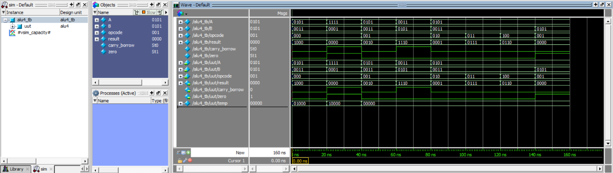
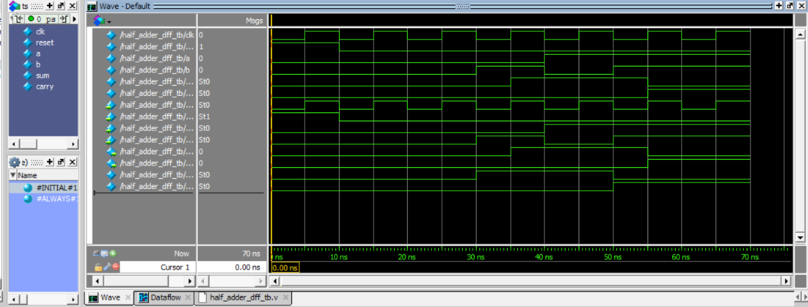
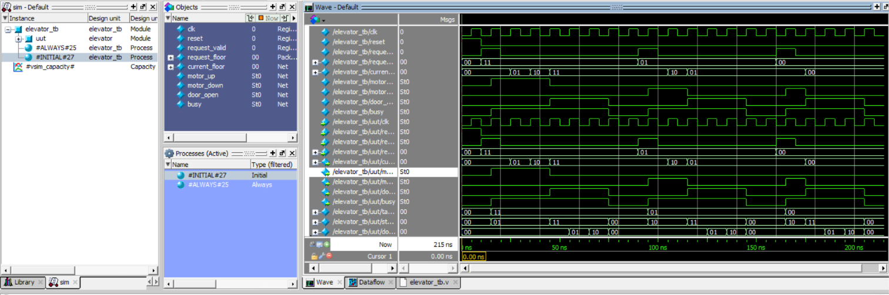
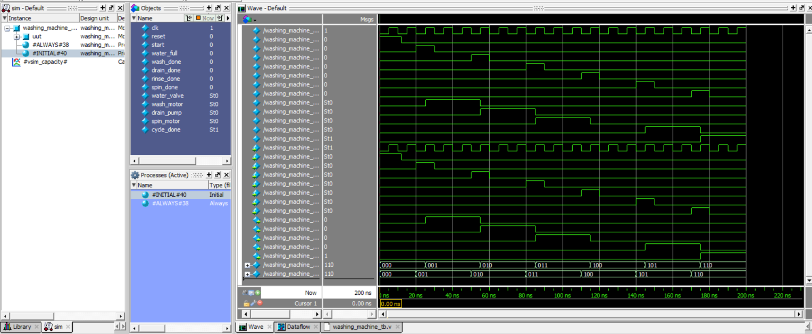
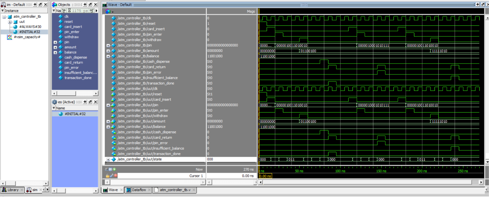
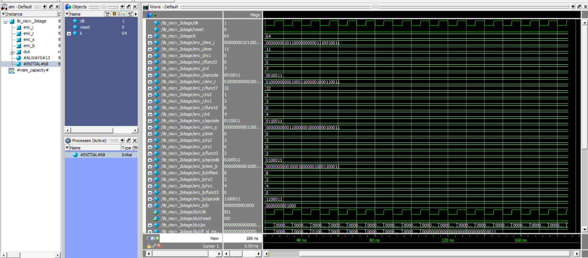
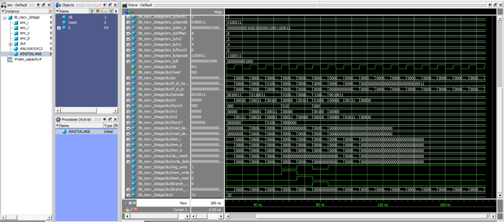
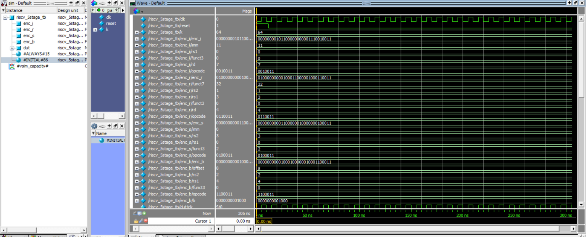
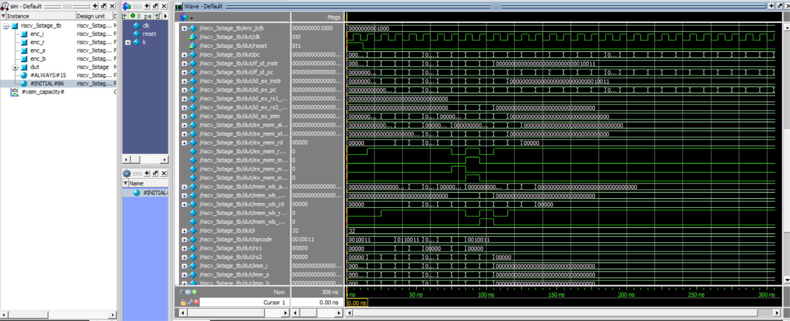
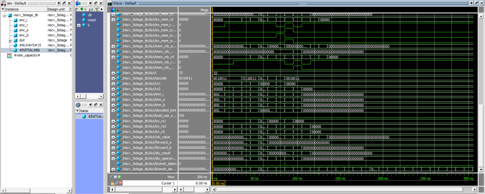

# Verilog HDL Digital Design Projects

A collection of digital logic designs, state machine controllers, pipelined processor architectures, and verification testbenches implemented in Verilog HDL, accompanied by functional simulation waveforms from ModelSim / QuestaSim.

---

## 📁 Repository Structure

```
Projects/
│
├── 01_Alu_4bit/
│   ├── alu4.v
│   ├── alu4_tb.v
│   └── output_Alu4bit.png
│
├── 02_4bit_halfadder/
│   ├── halfadder.v
│   ├── halfadder_tb.v
│   └── output_4bithalfadder.png
│
├── 03_D_FlipFlop/
│   ├── d_flipflop.v
│   ├── d_flipflop_tb.v
│   └── output_Dflipflop.png
│
├── 04_Half_Adder_DFF/
│   ├── half_adder_dff.v
│   ├── half_adder_dff_tb.v
│   └── output_halfadder_dff.png
│
├── 05_4_Floor_Elevator/
│   ├── elevator.v
│   ├── elevator_tb.v
│   └── output_elevator.png
│
├── 06_FSM/
│   ├── washing_machine.v
│   ├── washing_machine_tb.v
│   └── output_washing_machine.png
│
├── 07_ATM_Controller/
│   ├── atm_controller.v
│   ├── atm_controller_tb.v
│   └── output_ATM.png
│
├── 08_RISCV_2stage/
│   ├── riscv_2stage.v
│   ├── tb_riscv_2stage.v
│   ├── ouput-1_risc2stage.png
│   └── ouput-2_risc2stage.png
│
├── 09_RISC_V_5Stage/
│   ├── riscv_5stage.v
│   ├── riscv_5stage_tb.v
│   ├── output-1_risc_v_5stage.png
│   ├── output-2_risc_v_5stage.png
│   └── output-3_risc_v_5stage.png
│
└── README.md
```

---

## 🛠️ Modules Overview

### 1. 4-Bit Arithmetic Logic Unit (`01_Alu_4bit/`)
Performs arithmetic and bitwise logical operations controlled by a 3-bit opcode selector with carry/borrow and zero flag generation.
- **Files**: [`alu4.v`](01_Alu_4bit/alu4.v), [`alu4_tb.v`](01_Alu_4bit/alu4_tb.v)
- **Inputs**: 4-bit operands `A`, `B`, 3-bit `opcode`
- **Outputs**: 4-bit `result`, 1-bit `carry_borrow`, 1-bit `zero` flag

| Opcode (`opcode[2:0]`) | Operation | Description | Flags Affected |
| :---: | :---: | :--- | :--- |
| `000` | **ADD** | Addition: `temp = A + B` | `carry_borrow` (carry out), `zero` |
| `001` | **SUB** | Subtraction: `result = A - B` | `carry_borrow` (borrow: `A < B`), `zero` |
| `010` | **AND** | Bitwise AND: `result = A & B` | `zero` |
| `011` | **OR** | Bitwise OR: `result = A \| B` | `zero` |
| `100` | **XOR** | Bitwise XOR: `result = A ^ B` | `zero` |
| Others | **Default** | Clears output (`4'b0000`) | `zero` |

#### ModelSim Simulation Commands
```tcl
cd 01_Alu_4bit
pwd
vlib work
vmap work work
vlog alu4_tb.v alu4.v
vsim work.alu4_tb
add wave -r *
run -all
wave zoom full
```

#### Simulation Waveform


---

### 2. Half Adder (`02_4bit_halfadder/`)
Implements standard half adder addition on binary inputs (`A` and `B`) generating `Sum` and `Carry` outputs.
- **Files**: [`halfadder.v`](02_4bit_halfadder/halfadder.v), [`halfadder_tb.v`](02_4bit_halfadder/halfadder_tb.v)
- **Logic Equations**:
  - `Sum   = A ^ B` (Bitwise XOR)
  - `Carry = A & B` (Bitwise AND)
- **Truth Table**:

| `A` | `B` | `Sum` | `Carry` |
| :---: | :---: | :---: | :---: |
| 0 | 0 | 0 | 0 |
| 0 | 1 | 1 | 0 |
| 1 | 0 | 1 | 0 |
| 1 | 1 | 0 | 1 |

#### ModelSim Simulation Commands
```tcl
cd 02_4bit_halfadder
pwd
vlib work
vmap work work
vlog halfadder_tb.v halfadder.v
vsim work.halfadder_tb
add wave -r *
run -all
wave zoom full
```

#### Simulation Waveform


---

### 3. D Flip-Flop (`03_D_FlipFlop/`)
Positive-edge triggered D flip-flop with active-high asynchronous reset.
- **Files**: [`d_flipflop.v`](03_D_FlipFlop/d_flipflop.v), [`d_flipflop_tb.v`](03_D_FlipFlop/d_flipflop_tb.v)
- **Ports**:
  - `clk`: Clock signal
  - `rst`: Asynchronous active-high reset
  - `d`: Data input
  - `q`: Registered output
- **Functionality**: When `rst = 1`, `q` is cleared to `0`. On `posedge clk` with `rst = 0`, `q <= d`.

#### ModelSim Simulation Commands
```tcl
cd 03_D_FlipFlop
pwd
vlib work
vmap work work
vlog d_flipflop_tb.v d_flipflop.v
vsim work.d_flipflop_tb
add wave -r *
run -all
wave zoom full
```

#### Simulation Waveform


---

### 4. Half Adder with D Flip-Flop (`04_Half_Adder_DFF/`)
Sequential half adder combining combinational logic with edge-triggered output registration.
- **Files**: [`half_adder_dff.v`](04_Half_Adder_DFF/half_adder_dff.v), [`half_adder_dff_tb.v`](04_Half_Adder_DFF/half_adder_dff_tb.v)
- **Ports**:
  - `clk`, `reset`: Clock and asynchronous active-high reset
  - `a`, `b`: 1-bit operands
  - `sum`, `carry`: Registered outputs captured on the clock edge
- **Functionality**:
  - Combinational logic: `s = a ^ b`, `c = a & b`
  - Registered outputs: On rising clock edge (`posedge clk`), `sum <= s` and `carry <= c`. When `reset = 1`, `sum <= 0` and `carry <= 0`.

#### ModelSim Simulation Commands
```tcl
cd 04_Half_Adder_DFF
pwd
vlib work
vmap work work
vlog half_adder_dff_tb.v half_adder_dff.v
vsim work.half_adder_dff_tb
add wave -r *
run -all
wave zoom full
```

#### Simulation Waveform


---

### 5. 4-Floor Elevator Controller (`05_4_Floor_Elevator/`)
Finite State Machine (FSM) based controller for a 4-floor passenger elevator with motor direction, door timing control, and busy signaling.
- **Files**: [`elevator.v`](05_4_Floor_Elevator/elevator.v), [`elevator_tb.v`](05_4_Floor_Elevator/elevator_tb.v)
- **Inputs**: `clk`, `reset`, `request_valid`, `request_floor[1:0]` (Floors 0 to 3)
- **Outputs**: `current_floor[1:0]`, `motor_up`, `motor_down`, `door_open`, `busy`
- **FSM States**:
  - `IDLE (00)`: Evaluates target floor against current floor upon `request_valid`.
  - `UP (01)`: Asserts `motor_up`, increments floor on each clock cycle until reaching target floor.
  - `DOWN (10)`: Asserts `motor_down`, decrements floor on each clock cycle until reaching target floor.
  - `DOOR (11)`: Asserts `door_open`, holds for door countdown cycles before returning to `IDLE`.

#### ModelSim Simulation Commands
```tcl
cd 05_4_Floor_Elevator
pwd
vlib work
vmap work work
vlog elevator_tb.v elevator.v
vsim work.elevator_tb
add wave -r *
run -all
wave zoom full
```

#### Simulation Waveform


---

### 6. Washing Machine Controller (`06_FSM/`)
Synthesizable Moore Finite State Machine controller managing a multi-stage automated laundry sequence with sensor handshaking.
- **Files**: [`washing_machine.v`](06_FSM/washing_machine.v), [`washing_machine_tb.v`](06_FSM/washing_machine_tb.v)
- **Inputs**: `clk`, `reset`, `start`, `water_full`, `wash_done`, `drain_done`, `rinse_done`, `spin_done`
- **Outputs**: `water_valve`, `wash_motor`, `drain_pump`, `spin_motor`, `cycle_done`
- **Cycle Stages & FSM Sequence**:

| State | Encoding | Trigger Condition | Active Actuator Output |
| :--- | :---: | :--- | :--- |
| `IDLE` | `000` | `start = 1` | None |
| `FILL` | `001` | `water_full = 1` | `water_valve = 1` |
| `WASH` | `010` | `wash_done = 1` | `wash_motor = 1` |
| `DRAIN` | `011` | `drain_done = 1` | `drain_pump = 1` |
| `RINSE` | `100` | `rinse_done = 1` | `water_valve = 1` / rinse |
| `SPIN` | `101` | `spin_done = 1` | `spin_motor = 1` |
| `DONE` | `110` | `start = 1` (restart) | `cycle_done = 1` |

#### ModelSim Simulation Commands
```tcl
cd 06_FSM
pwd
vlib work
vmap work work
vlog washing_machine_tb.v washing_machine.v
vsim work.washing_machine_tb
add wave -r *
run -all
wave zoom full
```

#### Simulation Waveform


---

### 7. ATM Controller (`07_ATM_Controller/`)
Comprehensive Finite State Machine modeling an Automated Teller Machine (ATM) controller verifying card insertion, 16-bit PIN validation, balance checks, cash dispensing, and error handling.
- **Files**: [`atm_controller.v`](07_ATM_Controller/atm_controller.v), [`atm_controller_tb.v`](07_ATM_Controller/atm_controller_tb.v)
- **Inputs**: `clk`, `reset`, `card_insert`, `pin[15:0]`, `pin_enter`, `withdraw`, `amount[7:0]`, `balance[7:0]`
- **Outputs**: `cash_dispense`, `card_return`, `pin_error`, `insufficient_balance`, `transaction_done`
- **FSM States**:
  - `IDLE (000)`: Waits for `card_insert`.
  - `PIN (001)`: Awaits user PIN input (`pin_enter`).
  - `VERIFY (010)`: Authenticates PIN (validates against stored PIN `1234`). Branches to `MENU` on success or `ERROR` on failure.
  - `MENU (011)`: Awaits user transaction selection (`withdraw`).
  - `CHECK (100)`: Validates withdrawal `amount <= balance`.
  - `DISPENSE (101)`: Asserts `cash_dispense = 1`.
  - `DONE (110)`: Asserts `card_return = 1` and `transaction_done = 1`, then returns to `IDLE`.
  - `ERROR (111)`: Flags `pin_error` or `insufficient_balance`, asserts `card_return = 1`, and resets to `IDLE`.

#### ModelSim Simulation Commands
```tcl
cd 07_ATM_Controller
pwd
vlib work
vmap work work
vlog atm_controller_tb.v atm_controller.v
vsim work.atm_controller_tb
add wave -r *
run -all
wave zoom full
```

#### Simulation Waveform


---

### 8. 2-Stage Pipelined 32-Bit RISC-V Processor (`08_RISCV_2stage/`)
A synthesizable 32-bit RISC-V processor implementing a 2-stage pipeline with separate Harvard-style instruction and data memories.
- **Files**: [`riscv_2stage.v`](08_RISCV_2stage/riscv_2stage.v), [`tb_riscv_2stage.v`](08_RISCV_2stage/tb_riscv_2stage.v)
- **Pipeline Architecture**:
  - **Stage 1 (IF - Instruction Fetch)**: Fetches 32-bit instructions from `instruction_mem` addressed by the Program Counter (`pc`). Handles branch redirection and flushes pipeline with `NOP` on taken branches.
  - **Stage 2 (EX - Decode, Execute, Memory & Write-Back)**: Decodes instructions, reads source registers from a 32-entry register file (`registers[0:31]`, `x0 = 0`), performs arithmetic/logical operations in the ALU, accesses `data_mem`, and writes results back to the destination register (`rd`).
- **Supported Instructions**:

| Instruction | Type | Syntax | Operation |
| :--- | :---: | :--- | :--- |
| `ADD` | R | `add rd, rs1, rs2` | `rd = rs1 + rs2` |
| `SUB` | R | `sub rd, rs1, rs2` | `rd = rs1 - rs2` |
| `AND` | R | `and rd, rs1, rs2` | `rd = rs1 & rs2` |
| `OR` | R | `or rd, rs1, rs2` | `rd = rs1 \| rs2` |
| `ADDI` | I | `addi rd, rs1, imm` | `rd = rs1 + imm` |
| `LW` | I | `lw rd, offset(rs1)` | `rd = data_mem[rs1 + offset]` |
| `SW` | S | `sw rs2, offset(rs1)` | `data_mem[rs1 + offset] = rs2` |
| `BEQ` | B | `beq rs1, rs2, offset` | If `rs1 == rs2`, `pc = pc + offset` (flushes pipeline with `NOP`) |

#### ModelSim Simulation Commands
```tcl
cd 08_RISCV_2stage
pwd
vlib work
vmap work work
vlog tb_riscv_2stage.v riscv_2stage.v
vsim work.tb_riscv_2stage
add wave -r *
run -all
wave zoom full
```

#### Simulation Waveforms




---

### 9. 5-Stage Pipelined 32-Bit RISC-V Processor (`09_RISC_V_5Stage/`)
A synthesizable 32-bit RISC-V processor implementing the classic 5-stage pipeline architecture with complete data forwarding, hazard detection, and branch flushing units.
- **Files**: [`riscv_5stage.v`](09_RISC_V_5Stage/riscv_5stage.v), [`riscv_5stage_tb.v`](09_RISC_V_5Stage/riscv_5stage_tb.v)
- **Pipeline Stages**:
  - **IF (Instruction Fetch)**: Manages `pc`, fetches 32-bit instructions from `instruction_mem`, and handles branch redirection.
  - **ID (Instruction Decode / Register Read)**: Decodes opcode, funct3, and funct7, reads operands from 32-entry register file (`registers[0:31]`, `x0 = 0`), and generates sign-extended immediates (`imm_i`, `imm_s`, `imm_b`).
  - **EX (Execute / Address Calculation)**: Computes arithmetic/logic operations in the ALU, resolves branch condition (`BEQ`), and dynamically selects forwarded operands from later pipeline stages.
  - **MEM (Memory Access)**: Accesses `data_mem` for load (`LW`) and store (`SW`) operations.
  - **WB (Write Back)**: Selects between ALU computation result and memory read data to write back to destination register (`rd`).
- **Hazard Handling & Forwarding**:
  - **Forwarding Unit**: Eliminates RAW (Read-After-Write) data stalls by forwarding results from `EX/MEM` and `MEM/WB` stages directly into the ALU inputs.
  - **Hazard Detection Unit**: Detects load-use data hazards and stalls the pipeline by freezing `pc` and `IF/ID`, inserting a bubble into `ID/EX`.
  - **Branch Flushing**: Flushes `IF/ID` and `ID/EX` pipeline registers with `NOP` (`0x00000013`) upon taken branches.
- **Supported Instructions**:

| Instruction | Type | Syntax | Operation |
| :--- | :---: | :--- | :--- |
| `ADD` | R | `add rd, rs1, rs2` | `rd = rs1 + rs2` |
| `SUB` | R | `sub rd, rs1, rs2` | `rd = rs1 - rs2` |
| `AND` | R | `and rd, rs1, rs2` | `rd = rs1 & rs2` |
| `OR` | R | `or rd, rs1, rs2` | `rd = rs1 \| rs2` |
| `ADDI` | I | `addi rd, rs1, imm` | `rd = rs1 + imm` |
| `LW` | I | `lw rd, offset(rs1)` | `rd = data_mem[rs1 + offset]` |
| `SW` | S | `sw rs2, offset(rs1)` | `data_mem[rs1 + offset] = rs2` |
| `BEQ` | B | `beq rs1, rs2, offset` | If `rs1 == rs2`, `pc = branch_target` (flushes pipeline with `NOP`) |

#### ModelSim Simulation Commands
```tcl
cd 09_RISC_V_5Stage
pwd
vlib work
vmap work work
vlog riscv_5stage_tb.v riscv_5stage.v
vsim work.riscv_5stage_tb
add wave -r *
run -all
wave zoom full
```

#### Simulation Waveforms






---

## 🚀 Simulation & Verification Reference

### General ModelSim / QuestaSim Transcript Workflow

| Step | Command | Description |
| :---: | :--- | :--- |
| **01** | `pwd` | Verify current working directory |
| **02** | `vlib work` | Create the local design library |
| **03** | `vmap work work` | Map the library as default work library |
| **04** | `vlog <testbench>.v <design>.v` | Compile design and testbench files |
| **05** | `vsim work.<testbench_module>` | Load testbench for simulation |
| **06** | `add wave -r *` | Add all signals recursively to waveform window |
| **07** | `run -all` | Execute simulation run |
| **08** | `wave zoom full` | Zoom to fit all waveforms in window |


---

## 🎓 Workshop Assignment: Verilog RTL Design & RISC-V Processor Development (4-Day)

**Trainer:** Yuvaraj Seenipandi — Infoziant | Kalasalingam University  
**Student:** Bommu Gowtham Sai Reddy

---

### Day 1 — Combinational & Sequential Building Blocks (`day1/`)

| Activity | Module | Description | Tests |
| :--- | :--- | :--- | :---: |
| 1.1 | `alu.v` | 32-bit Parameterized ALU (ADD, SUB, AND, OR, XOR, SLT, SLL, SRL) with flags | 27 PASSED |
| 1.2 | `counter.v` | 8-bit Up/Down Counter with Sync Reset, Enable, Parallel Load | 15 PASSED |
| 1.3 | `shifter.v` | 32-bit Barrel Shifter (SLL, SRL, SRA by 0–31) | 480 PASSED |
| 1.4 | `regfile.v` | 32x32 Register File, hardwired x0=0, write-bypass forwarding | 264 PASSED |
| 1.5 | `adder_sub.v` | Structural 8-bit Ripple-Carry Adder/Subtractor with generate | 512 PASSED |
| 1.6 | `encoder.v`, `decoder.v` | 8-to-3 Priority Encoder (casez vs if-else) + 3-to-8 Decoder | 272 PASSED |
| 1.7 | `shiftreg.v`, `lfsr.v` | Universal Shift Register + 8-bit Maximal-Length LFSR (255 states) | 6 PASSED |
| 1.8 | `debounce.v`, `edge_detect.v` | Counter Debouncer + 2-Stage Synchronizer Edge Detector | 6 PASSED |

#### 1.1 — Parameterized ALU
```tcl
cd day1
vlib work
vmap work work
vlog src/alu.v tb/alu_tb.v
vsim work.alu_tb
add wave -r *
run -all
wave zoom full
```

#### 1.2 — Up/Down Counter
```tcl
cd day1
vlib work
vmap work work
vlog src/counter.v tb/counter_tb.v
vsim work.counter_tb
add wave -r *
run -all
wave zoom full
```

#### 1.3 — Barrel Shifter
```tcl
cd day1
vlib work
vmap work work
vlog src/shifter.v tb/shifter_tb.v
vsim work.shifter_tb
add wave -r *
run -all
wave zoom full
```

#### 1.4 — Register File
```tcl
cd day1
vlib work
vmap work work
vlog src/regfile.v tb/regfile_tb.v
vsim work.regfile_tb
add wave -r *
run -all
wave zoom full
```

#### 1.5 — Ripple-Carry Adder/Subtractor
```tcl
cd day1
vlib work
vmap work work
vlog src/full_adder.v src/adder_sub.v tb/adder_sub_tb.v
vsim work.adder_sub_tb
add wave -r *
run -all
wave zoom full
```

#### 1.6 — Priority Encoder & Decoder
```tcl
cd day1
vlib work
vmap work work
vlog src/encoder.v src/decoder.v tb/encoder_decoder_tb.v
vsim work.encoder_decoder_tb
add wave -r *
run -all
wave zoom full
```

#### 1.7 — LFSR & Universal Shift Register
```tcl
cd day1
vlib work
vmap work work
vlog src/shiftreg.v src/lfsr.v tb/shiftreg_lfsr_tb.v
vsim work.shiftreg_lfsr_tb
add wave -r *
run -all
wave zoom full
```

#### 1.8 — Debouncer & Edge Detector
```tcl
cd day1
vlib work
vmap work work
vlog src/debounce.v src/edge_detect.v tb/debounce_edge_tb.v
vsim work.debounce_edge_tb
add wave -r *
run -all
wave zoom full
```

---

### Day 2 — FSM Controllers & Memory Design (`day2/`)

| Activity | Module | Description | Tests |
| :--- | :--- | :--- | :---: |
| 2.1 | `seq_moore.v`, `seq_mealy.v` | Overlapping 1011 Sequence Detector (Moore & Mealy comparison) | 32 PASSED |
| 2.2 | `vending.v` | Vending Machine FSM accepting ₹5/₹10/₹20 with change return | 8 PASSED |
| 2.3 | `fifo.v` | 16x8 Synchronous FIFO with Full/Empty/Almost flags, overflow protection | 22 PASSED |
| 2.4 | Report | FSM Encoding, Moore/Mealy tradeoffs, CDC FIFO analysis | Completed |
| 2.5 | `traffic_light.v` | Traffic Light FSM with Green/Yellow/Red timers + pedestrian button | 6 PASSED |
| 2.6 | `atm.v` | ATM Controller FSM with PIN lockout, withdrawal, overdraft protection | 5 PASSED |
| 2.7 | `arbiter.v` | 4-Way Round-Robin Arbiter with rotating priority pointer | 10 PASSED |
| 2.8 | `ram.v`, `watchdog.v` | 64x32 Synchronous RAM + Auto-Reload Watchdog Timer | 23 PASSED |

#### 2.1 — Sequence Detector (Moore & Mealy)
```tcl
cd day2
vlib work
vmap work work
vlog src/seq_moore.v src/seq_mealy.v tb/seq_tb.v
vsim work.seq_tb
add wave -r *
run -all
wave zoom full
```

#### 2.2 — Vending Machine FSM
```tcl
cd day2
vlib work
vmap work work
vlog src/vending.v tb/vending_tb.v
vsim work.vending_tb
add wave -r *
run -all
wave zoom full
```

#### 2.3 — Synchronous FIFO (16×8)
```tcl
cd day2
vlib work
vmap work work
vlog src/fifo.v tb/fifo_tb.v
vsim work.fifo_tb
add wave -r *
run -all
wave zoom full
```

#### 2.4 — FSM Design Review
> 📄 Theory report only — no simulation required.  
> See [`report/review_note_2_4.md`](../report/review_note_2_4.md) — FSM encoding (Binary/One-Hot/Gray), Moore vs Mealy trade-offs, CDC FIFO with Gray code pointers.

#### 2.5 — Traffic Light Controller
```tcl
cd day2
vlib work
vmap work work
vlog src/traffic_light.v tb/traffic_light_tb.v
vsim work.traffic_light_tb
add wave -r *
run -all
wave zoom full
```

#### 2.6 — ATM Controller FSM
```tcl
cd day2
vlib work
vmap work work
vlog src/atm.v tb/atm_tb.v
vsim work.atm_tb
add wave -r *
run -all
wave zoom full
```

#### 2.7 — Round-Robin Arbiter
```tcl
cd day2
vlib work
vmap work work
vlog src/arbiter.v tb/arbiter_tb.v
vsim work.arbiter_tb
add wave -r *
run -all
wave zoom full
```

#### 2.8 — RAM & Watchdog Timer
```tcl
cd day2
vlib work
vmap work work
vlog src/ram.v src/watchdog.v tb/ram_watchdog_tb.v
vsim work.ram_watchdog_tb
add wave -r *
run -all
wave zoom full
```

---

### Day 3 — Single-Cycle RV32I CPU (`day3/`)

| Activity | Module / File | Description | Tests |
| :--- | :--- | :--- | :---: |
| 3.1 | `report/rv32i_decode_table.md` | Full RV32I Control Table (R/I/S/B/U/J types) | Completed |
| 3.2 | `program1_sum.hex`, `program2_fib.hex`, `program3_max.hex` | Machine code: Sum(1..10)=55, Fibonacci first 8, Array Max | Completed |
| 3.3 | `cpu.v`, `cpu_tb.v` | Full-featured single-cycle RV32I processor + testbench | 3 PASSED |
| 3.4 | `report/waveform_analysis_3_4.md` | Waveform analysis for ADDI/SW/LW/BLT/JAL datapath signals | Completed |
| 3.7 | `report/instruction_coverage.md` | RV32I instruction coverage matrix & corner case table | Completed |
| 3.8 | `report/bughunt_notes.md` | RTL bug-hunt: x0 overwrite, imm bit-scramble, SRA/signed, BLT | Completed |

#### 3.1 / 3.2 / 3.3 / 3.5 / 3.6 — Full RV32I Single-Cycle CPU
> Activities 3.1, 3.2, 3.5, 3.6 all simulate through the same `cpu.v` + `cpu_tb.v`.  
> The testbench runs all 3 programs: Sum(1..10)=55, Fibonacci first 8, Array Max=78.
```tcl
cd day3
vlib work
vmap work work
vlog src/cpu.v tb/cpu_tb.v
vsim work.cpu_tb
add wave -r *
run -all
wave zoom full
```

#### 3.4 — Waveform Analysis
> 📄 Report only — See [`report/waveform_analysis_3_4.md`](../report/waveform_analysis_3_4.md)

#### 3.7 — Instruction Coverage
> 📄 Report only — See [`report/instruction_coverage.md`](../report/instruction_coverage.md)

#### 3.8 — Bug Hunt Notes
> 📄 Report only — See [`report/bughunt_notes.md`](../report/bughunt_notes.md)

---

### Day 4 — 5-Stage Pipeline Hazards & Analysis (`day4/`)

| Activity | Module / File | Description | Tests |
| :--- | :--- | :--- | :---: |
| 4.1 | `forwarding_unit.v`, `riscv_5stage.v` | 5-Stage Pipeline + EX/MEM & MEM/WB Forwarding Unit | 4 PASSED |
| 4.2 | `hazard_unit.v` | Load-Use Hazard Detection with stall bubble insertion | Verified |
| 4.3 | `report/cpi_comparison.md` | CPI Analysis: single-cycle vs. pipeline + penalty formula | Completed |
| 4.5 | `report/hazard_waveform_4_5.md` | Waveform trace of load-use stall and branch flush timing | Completed |
| 4.6 | `riscv_5stage.v` | Branch flush on taken BEQ — flush IF+ID stages | Verified |
| 4.7 | `riscv_5stage.v` | Hardware performance counters: cycles, instret, stalls, flushes | Verified |
| 4.8 | `report/architecture_diagram_4_8.md` | Pipeline datapath diagram + hazard resolution summary table | Completed |

#### 4.1 / 4.2 / 4.6 / 4.7 — Full 5-Stage Pipeline
> Activities 4.1, 4.2, 4.6, 4.7 all simulate through the same pipeline files.  
> Single testbench tests forwarding, load-use stalls, branch flush, and performance counters.
```tcl
cd day4
vlib work
vmap work work
vlog src/forwarding_unit.v src/hazard_unit.v src/riscv_5stage.v tb/riscv_5stage_tb.v
vsim work.riscv_5stage_tb
add wave -r *
run -all
wave zoom full
```

#### 4.3 — CPI Comparison
> 📄 Report only — See [`report/cpi_comparison.md`](../report/cpi_comparison.md)

#### 4.5 — Hazard Waveform Analysis
> 📄 Report only — See [`report/hazard_waveform_4_5.md`](../report/hazard_waveform_4_5.md)

#### 4.8 — Architecture Diagram
> 📄 Report only — See [`report/architecture_diagram_4_8.md`](../report/architecture_diagram_4_8.md)

---

### Workshop Report Files (`report/`)

| File | Content |
| :--- | :--- |
| `review_note_2_4.md` | FSM encoding analysis (Binary/One-Hot/Gray), Moore vs Mealy, CDC FIFO |
| `rv32i_decode_table.md` | Complete RV32I instruction decode & control signal table |
| `waveform_analysis_3_4.md` | Detailed signal-by-signal waveform explanation for 5 key instructions |
| `instruction_coverage.md` | Instruction coverage matrix and corner case verification summary |
| `bughunt_notes.md` | 4 real RTL bug root-cause analyses and register-transfer fixes |
| `cpi_comparison.md` | Measured CPI data, penalty cycle analysis, and performance formula |
| `hazard_waveform_4_5.md` | Load-use stall and branch flush pipeline timing diagrams |
| `architecture_diagram_4_8.md` | Full 5-stage pipeline architecture diagram with forwarding paths |

---

### Completion Checklist

- [x] Day 1: All 8 activities — 1,582 / 1,582 test assertions PASSED
- [x] Day 2: All 8 activities — 106 / 106 test assertions PASSED
- [x] Day 3: RV32I CPU — 3 programs verified (Sum=55, Fib[8], MaxArray=78)
- [x] Day 4: 5-Stage Pipeline — 4 / 4 self-checks PASSED (forwarding + stall + flush)
- [x] All waveforms generated in `dayX/waves/*.wlf`
- [x] All tech notes and reports completed in `report/`
- [x] Repository pushed to `https://github.com/BOMMUGOWTHAMSAIREDDY97/RISC-V_WORKSHOP.git`
