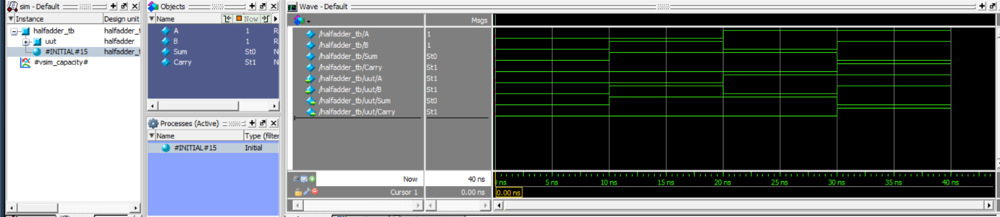
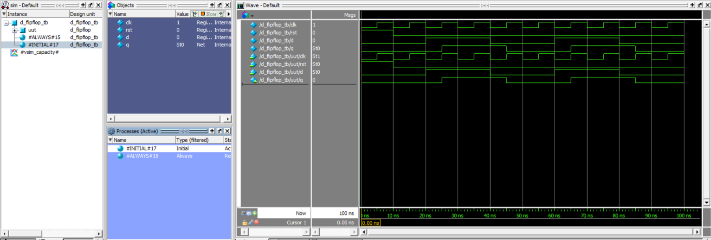

# Verilog HDL Digital Design Projects

A collection of digital logic designs, state machine controllers, pipelined processor architectures, and verification testbenches implemented in Verilog HDL, accompanied by functional simulation waveforms from ModelSim / QuestaSim.

---

## 📁 Repository Structure

```
Projects/
│
├── 4bit_halfadder/
│   ├── halfadder.v
│   ├── halfadder_tb.v
│   └── output_4bithalfadder.png
│
├── 4_Floor_Elevator/
│   ├── elevator.v
│   ├── elevator_tb.v
│   └── output_elevator.png
│
├── Alu_4bit/
│   ├── alu4.v
│   ├── alu4_tb.v
│   └── output_Alu4bit.png
│
├── ATM_Controller/
│   ├── atm_controller.v
│   ├── atm_controller_tb.v
│   └── output_ATM.png
│
├── D_FlipFlop/
│   ├── d_flipflop.v
│   ├── d_flipflop_tb.v
│   └── output_Dflipflop.png
│
├── FSM/
│   ├── washing_machine.v
│   ├── washing_machine_tb.v
│   └── output_washing_machine.png
│
├── Half_Adder_DFF/
│   ├── half_adder_dff.v
│   ├── half_adder_dff_tb.v
│   └── output_halfadder_dff.png
│
├── RISCV_2stage/
│   ├── riscv_2stage.v
│   ├── tb_riscv_2stage.v
│   ├── ouput-1_risc2stage.png
│   └── ouput-2_risc2stage.png
│
└── README.md
```

---

## 🛠️ Modules Overview

### 1. Half Adder (`4bit_halfadder/`)
Implements standard half adder addition on binary inputs (`A` and `B`) generating `Sum` and `Carry` outputs.
- **Files**: [`halfadder.v`](4bit_halfadder/halfadder.v), [`halfadder_tb.v`](4bit_halfadder/halfadder_tb.v)
- **Logic Equations**:
  - `Sum   = A ^ B` (Bitwise XOR)
  - `Carry = A & B` (Bitwise AND)
- **Truth Table**:

| `A` | `B` | `Sum` | `Carry` |
| :---: | :---: | :---: | :---: |
| 0 | 0 | 0 | 0 |
| 0 | 1 | 1 | 0 |
| 1 | 0 | 1 | 0 |
| 1 | 1 | 0 | 1 |

#### Simulation Waveform


---

### 2. 4-Floor Elevator Controller (`4_Floor_Elevator/`)
Finite State Machine (FSM) based controller for a 4-floor passenger elevator with motor direction, door timing control, and busy signaling.
- **Files**: [`elevator.v`](4_Floor_Elevator/elevator.v), [`elevator_tb.v`](4_Floor_Elevator/elevator_tb.v)
- **Inputs**: `clk`, `reset`, `request_valid`, `request_floor[1:0]` (Floors 0 to 3)
- **Outputs**: `current_floor[1:0]`, `motor_up`, `motor_down`, `door_open`, `busy`
- **FSM States**:
  - `IDLE (00)`: Evaluates target floor against current floor upon `request_valid`.
  - `UP (01)`: Asserts `motor_up`, increments floor on each clock cycle until reaching target floor.
  - `DOWN (10)`: Asserts `motor_down`, decrements floor on each clock cycle until reaching target floor.
  - `DOOR (11)`: Asserts `door_open`, holds for door countdown cycles before returning to `IDLE`.

#### Simulation Waveform


---

### 3. 4-Bit Arithmetic Logic Unit (`Alu_4bit/`)
Performs arithmetic and bitwise logical operations controlled by a 3-bit opcode selector with carry/borrow and zero flag generation.
- **Files**: [`alu4.v`](Alu_4bit/alu4.v), [`alu4_tb.v`](Alu_4bit/alu4_tb.v)
- **Inputs**: 4-bit operands `A`, `B`, 3-bit `opcode`
- **Outputs**: 4-bit `result`, 1-bit `carry_borrow`, 1-bit `zero` flag

| Opcode (`opcode[2:0]`) | Operation | Description | Flags Affected |
| :---: | :---: | :--- | :--- |
| `000` | **ADD** | Addition: `temp = A + B` | `carry_borrow` (carry out), `zero` |
| `001` | **SUB** | Subtraction: `result = A - B` | `carry_borrow` (borrow: `A < B`), `zero` |
| `010` | **AND** | Bitwise AND: `result = A & B` | `zero` |
| `011` | **OR** | Bitwise OR: `result = A \| B` | `zero` |
| `100` | **XOR** | Bitwise XOR: `result = A ^ B` | `zero` |
| Others | **Default** | Clears output (`4'b0000`) | `zero` |

#### Simulation Waveform


---

### 4. ATM Controller (`ATM_Controller/`)
Comprehensive Finite State Machine modeling an Automated Teller Machine (ATM) controller verifying card insertion, 16-bit PIN validation, balance checks, cash dispensing, and error handling.
- **Files**: [`atm_controller.v`](ATM_Controller/atm_controller.v), [`atm_controller_tb.v`](ATM_Controller/atm_controller_tb.v)
- **Inputs**: `clk`, `reset`, `card_insert`, `pin[15:0]`, `pin_enter`, `withdraw`, `amount[7:0]`, `balance[7:0]`
- **Outputs**: `cash_dispense`, `card_return`, `pin_error`, `insufficient_balance`, `transaction_done`
- **FSM States**:
  - `IDLE (000)`: Waits for `card_insert`.
  - `PIN (001)`: Awaits user PIN input (`pin_enter`).
  - `VERIFY (010)`: Authenticates PIN (validates against stored PIN `1234`). Branches to `MENU` on success or `ERROR` on failure.
  - `MENU (011)`: Awaits user transaction selection (`withdraw`).
  - `CHECK (100)`: Validates withdrawal `amount <= balance`.
  - `DISPENSE (101)`: Asserts `cash_dispense = 1`.
  - `DONE (110)`: Asserts `card_return = 1` and `transaction_done = 1`, then returns to `IDLE`.
  - `ERROR (111)`: Flags `pin_error` or `insufficient_balance`, asserts `card_return = 1`, and resets to `IDLE`.

#### Simulation Waveform


---

### 5. D Flip-Flop (`D_FlipFlop/`)
Positive-edge triggered D flip-flop with active-high asynchronous reset.
- **Files**: [`d_flipflop.v`](D_FlipFlop/d_flipflop.v), [`d_flipflop_tb.v`](D_FlipFlop/d_flipflop_tb.v)
- **Ports**:
  - `clk`: Clock signal
  - `rst`: Asynchronous active-high reset
  - `d`: Data input
  - `q`: Registered output
- **Functionality**: When `rst = 1`, `q` is cleared to `0`. On `posedge clk` with `rst = 0`, `q <= d`.

#### Simulation Waveform


---

### 6. Washing Machine Controller (`FSM/`)
Synthesizable Moore Finite State Machine controller managing a multi-stage automated laundry sequence with sensor handshaking.
- **Files**: [`washing_machine.v`](FSM/washing_machine.v), [`washing_machine_tb.v`](FSM/washing_machine_tb.v)
- **Inputs**: `clk`, `reset`, `start`, `water_full`, `wash_done`, `drain_done`, `rinse_done`, `spin_done`
- **Outputs**: `water_valve`, `wash_motor`, `drain_pump`, `spin_motor`, `cycle_done`
- **Cycle Stages & FSM Sequence**:

| State | Encoding | Trigger Condition | Active Actuator Output |
| :--- | :---: | :--- | :--- |
| `IDLE` | `000` | `start = 1` | None |
| `FILL` | `001` | `water_full = 1` | `water_valve = 1` |
| `WASH` | `010` | `wash_done = 1` | `wash_motor = 1` |
| `DRAIN` | `011` | `drain_done = 1` | `drain_pump = 1` |
| `RINSE` | `100` | `rinse_done = 1` | `water_valve = 1` / rinse |
| `SPIN` | `101` | `spin_done = 1` | `spin_motor = 1` |
| `DONE` | `110` | `start = 1` (restart) | `cycle_done = 1` |

#### Simulation Waveform


---

### 7. Half Adder with D Flip-Flop (`Half_Adder_DFF/`)
Sequential half adder combining combinational logic with edge-triggered output registration.
- **Files**: [`half_adder_dff.v`](Half_Adder_DFF/half_adder_dff.v), [`half_adder_dff_tb.v`](Half_Adder_DFF/half_adder_dff_tb.v)
- **Ports**:
  - `clk`, `reset`: Clock and asynchronous active-high reset
  - `a`, `b`: 1-bit operands
  - `sum`, `carry`: Registered outputs captured on the clock edge
- **Functionality**:
  - Combinational logic: `s = a ^ b`, `c = a & b`
  - Registered outputs: On rising clock edge (`posedge clk`), `sum <= s` and `carry <= c`. When `reset = 1`, `sum <= 0` and `carry <= 0`.

#### Simulation Waveform


---

### 8. 2-Stage Pipelined 32-Bit RISC-V Processor (`RISCV_2stage/`)
A synthesizable 32-bit RISC-V processor implementing a 2-stage pipeline with separate Harvard-style instruction and data memories.
- **Files**: [`riscv_2stage.v`](RISCV_2stage/riscv_2stage.v), [`tb_riscv_2stage.v`](RISCV_2stage/tb_riscv_2stage.v)
- **Pipeline Architecture**:
  - **Stage 1 (IF - Instruction Fetch)**: Fetches 32-bit instructions from `instruction_mem` addressed by the Program Counter (`pc`). Handles branch redirection and flushes pipeline with `NOP` on taken branches.
  - **Stage 2 (EX - Decode, Execute, Memory & Write-Back)**: Decodes instructions, reads source registers from a 32-entry register file (`registers[0:31]`, `x0 = 0`), performs arithmetic/logical operations in the ALU, accesses `data_mem`, and writes results back to the destination register (`rd`).
- **Supported Instructions**:

| Instruction | Type | Syntax | Operation |
| :--- | :---: | :--- | :--- |
| `ADD` | R | `add rd, rs1, rs2` | `rd = rs1 + rs2` |
| `SUB` | R | `sub rd, rs1, rs2` | `rd = rs1 - rs2` |
| `AND` | R | `and rd, rs1, rs2` | `rd = rs1 & rs2` |
| `OR` | R | `or rd, rs1, rs2` | `rd = rs1 \| rs2` |
| `ADDI` | I | `addi rd, rs1, imm` | `rd = rs1 + imm` |
| `LW` | I | `lw rd, offset(rs1)` | `rd = data_mem[rs1 + offset]` |
| `SW` | S | `sw rs2, offset(rs1)` | `data_mem[rs1 + offset] = rs2` |
| `BEQ` | B | `beq rs1, rs2, offset` | If `rs1 == rs2`, `pc = pc + offset` (flushes pipeline with `NOP`) |

#### Simulation Waveforms


---

## 🚀 Simulation & Verification

Follow these step-by-step commands in the ModelSim / QuestaSim Transcript console:

### ModelSim / QuestaSim Simulation Commands

| Step | Command | Description |
| :---: | :--- | :--- |
| **01** | `pwd` | Verify current working directory |
| **02** | `vlib work` | Create the local design library |
| **03** | `vmap work work` | Map the library as default work library |
| **04** | `vlog <testbench>.v <design>.v` | Compile design and testbench files |
| **05** | `vsim work.<testbench_module>` | Load testbench for simulation |
| **06** | `add wave -r *` | Add all signals recursively to waveform window |
| **07** | `run -all` | Execute simulation run |
| **08** | `wave zoomfull` | Zoom to fit all waveforms in window |

---

### Running Each Module in ModelSim

- **2-Stage RISC-V Processor (`RISCV_2stage/`)**:
  ```tcl
  cd RISCV_2stage
  pwd
  vlib work
  vmap work work
  vlog tb_riscv_2stage.v riscv_2stage.v
  vsim work.tb_riscv_2stage
  add wave -r *
  run -all
  wave zoomfull
  ```

- **Half Adder (`4bit_halfadder/`)**:
  ```tcl
  cd 4bit_halfadder
  pwd
  vlib work
  vmap work work
  vlog halfadder_tb.v halfadder.v
  vsim work.halfadder_tb
  add wave -r *
  run -all
  wave zoomfull
  ```

- **4-Floor Elevator Controller (`4_Floor_Elevator/`)**:
  ```tcl
  cd 4_Floor_Elevator
  pwd
  vlib work
  vmap work work
  vlog elevator_tb.v elevator.v
  vsim work.elevator_tb
  add wave -r *
  run -all
  wave zoomfull
  ```

- **4-Bit ALU (`Alu_4bit/`)**:
  ```tcl
  cd Alu_4bit
  pwd
  vlib work
  vmap work work
  vlog alu4_tb.v alu4.v
  vsim work.alu4_tb
  add wave -r *
  run -all
  wave zoomfull
  ```

- **ATM Controller (`ATM_Controller/`)**:
  ```tcl
  cd ATM_Controller
  pwd
  vlib work
  vmap work work
  vlog atm_controller_tb.v atm_controller.v
  vsim work.atm_controller_tb
  add wave -r *
  run -all
  wave zoomfull
  ```

- **D Flip-Flop (`D_FlipFlop/`)**:
  ```tcl
  cd D_FlipFlop
  pwd
  vlib work
  vmap work work
  vlog d_flipflop_tb.v d_flipflop.v
  vsim work.d_flipflop_tb
  add wave -r *
  run -all
  wave zoomfull
  ```

- **Washing Machine Controller (`FSM/`)**:
  ```tcl
  cd FSM
  pwd
  vlib work
  vmap work work
  vlog washing_machine_tb.v washing_machine.v
  vsim work.washing_machine_tb
  add wave -r *
  run -all
  wave zoomfull
  ```

- **Half Adder with DFF (`Half_Adder_DFF/`)**:
  ```tcl
  cd Half_Adder_DFF
  pwd
  vlib work
  vmap work work
  vlog half_adder_dff_tb.v half_adder_dff.v
  vsim work.half_adder_dff_tb
  add wave -r *
  run -all
  wave zoomfull
  ```
